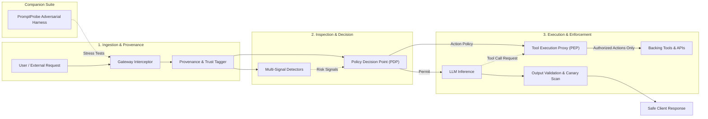

# SentinelLLM

**Runtime Security Controls and Adversarial Defense-in-Depth for LLM Applications and AI Agents**

[](LICENSE)
[](pyproject.toml)

---

## Current Status

> **Status: Foundation in progress; security controls and evaluation features are planned.**
>
> This repository currently contains the foundational architecture, engineering standards, static quality gates, CI pipelines, and research specifications. Concrete security runtime engines, interception proxies, and benchmark harnesses are scheduled for progressive development in upcoming milestones.

---

## Overview & Value Proposition

Large Language Models (LLMs) deployed in autonomous agents, customer-facing interfaces, and enterprise workflows introduce critical new vulnerability classes—most notably **direct prompt injection**, **indirect prompt injection via untrusted retrieval (RAG)**, **privilege escalation**, and **unauthorized tool invocation**.

Conventional defensive approaches rely heavily on probabilistic content filtering (prompt-level admonitions, regex filters, or classification heads). While necessary, probabilistic filters are vulnerable to adaptive token smuggling, cipher encoding, and multi-turn context evasion. Furthermore, aggressive input filtering degrades system utility by blocking legitimate, domain-specific user requests.

**SentinelLLM** addresses this challenge through a defense-in-depth architecture that decouples **probabilistic signal detection** from **deterministic action-level policy enforcement**. By introducing strict trust boundaries, context provenance tracking, and an out-of-band tool authorization proxy (PEP), SentinelLLM enforces least-privilege security guarantees even if the underlying model is tricked or jailbroken.

Its companion framework, **PromptProbe**, provides an automated adversarial evaluation harness to rigorously test LLM applications, measure security–utility trade-offs, and conduct reproducible ablation studies.

---

## Core System Responsibilities

### 1. SentinelLLM (Runtime Protection Engine)
- **Lifecycle Gateway:** Intercepts inbound prompts, session context, and external data to normalize representations and establish execution correlation.
- **Trust Boundaries & Data Provenance:** Assigns immutable trust tiers to inputs (e.g., system instructions vs. authenticated user prompt vs. untrusted RAG chunk) to prevent instruction-data conflation.
- **Multi-Signal Detectors:** Swappable analytical checks (heuristic signatures, canary token monitors, semantic classifiers) providing probabilistic risk scores.
- **Policy Decision Point (PDP):** Evaluates risk signals, caller identity, and provenance tiers to render deterministic verdicts (`ALLOW`, `SANITIZE`, `BLOCK`, `DEGRADE`).
- **Tool Execution Policy Enforcement Point (PEP):** Intercepts model tool calls out-of-band, validating action permissions and taint propagation before invoking backing APIs or system functions.
- **Output Validation & Egress Guard:** Scans responses for system canary token leakage, PII, and unauthorized data exfiltration channels.
- **Structured Audit Logging:** Produces immutable, privacy-conscious audit telemetry for security observability.

### 2. PromptProbe (Adversarial Evaluation Suite)
- **Decoupled Evaluation Harness:** Evaluates SentinelLLM defenses, external frameworks, and raw foundation models independently.
- **Adversarial Test Suites:** Systematic execution of direct injection, indirect injection, and privilege escalation benchmarks.
- **Metric Computation:** Formal measurement of Attack Success Rate (ASR), Unauthorized Tool Execution Rate (UTER), False Positive Rate (FPR), and Benign Task Completion Rate (TCR).
- **Ablation Framework:** Controlled isolation of individual defense layers to measure their precise security and utility contributions.

---

## Planned Architecture



For full architectural details, component interfaces, and trust boundaries, refer to [docs/architecture.md](docs/architecture.md).

---

## Technology & Engineering Standards

- **Language:** Python 3.12+ (strictly typed, PEP 561 compliant).
- **Build System:** PEP 621 compliant configuration with setuptools.
- **Code Quality & Formatting:** Ruff (linting, formatting, import sorting).
- **Static Type Analysis:** Mypy in strict mode (`--strict`).
- **Test Framework:** Pytest with branch coverage reporting via `pytest-cov`.
- **Pre-commit Automation:** Automated local Git hooks via `pre-commit`.
- **Continuous Integration:** GitHub Actions matrix builds covering Python 3.12 and 3.13.

---

## Repository Structure

```text
SentinelLLM/
├── .github/
│   └── workflows/
│       └── ci.yml               # GitHub Actions CI workflow
├── docs/
│   ├── architecture.md          # Architectural specifications & component boundaries
│   ├── threat-model.md          # Assets, threat actors, attack vectors & mitigations
│   ├── development.md           # Local environment setup and developer guide
│   └── research-plan.md         # Research questions, metrics, baselines & ablations
├── src/
│   └── sentinelllm/             # SentinelLLM core runtime package
│       ├── __init__.py          # Package initialization and versioning
│       └── py.typed             # PEP 561 typing marker
├── promptprobe/                 # Decoupled adversarial evaluation harness
│   ├── __init__.py              # Evaluation suite initialization
│   └── README.md                # PromptProbe architecture and mission
├── tests/
│   ├── unit/                    # Fast isolated component unit tests
│   ├── integration/             # End-to-end component interaction tests
│   └── security/                # Security regression tests and trust boundary checks
├── benchmarks/
│   ├── configs/                 # Benchmark preset configurations
│   ├── datasets/                # Benchmark dataset schemas and references
│   └── results/                 # Evaluation outputs (git-ignored, reproducible)
├── scripts/                     # Developer and research maintenance scripts
├── .editorconfig                # Cross-editor formatting specifications
├── .env.example                 # Non-secret environment configuration template
├── .gitignore                   # Comprehensive Git ignore rules
├── .pre-commit-config.yaml      # Quality gate pre-commit hooks
├── CONTRIBUTING.md              # Contribution standards and testing guidelines
├── LICENSE                      # MIT License
├── Makefile                     # Standard developer commands
├── pyproject.toml               # Unified project metadata and tool configs
├── README.md                    # Project overview and documentation index
└── SECURITY.md                  # Vulnerability disclosure and responsible testing policy
```

---

## Installation & Development Setup

### Prerequisites
- Python 3.12 or newer
- Git

### Setup Instructions

1. **Clone the repository:**
   ```bash
   git clone https://github.com/yash-mishraa/SentinelLLM.git
   cd SentinelLLM
   ```

2. **Create and activate a virtual environment:**
   ```bash
   python3.12 -m venv .venv
   source .venv/bin/activate
   ```
   *(Alternatively, use `uv venv .venv --python 3.12 && source .venv/bin/activate`)*

3. **Install the package in editable mode with development dependencies:**
   ```bash
   make install
   # Or directly: pip install -e ".[dev]"
   ```

4. **Verify quality gates:**
   ```bash
   make check
   ```

---

## Development Commands

All common tasks are automated via the `Makefile`:

| Target | Command | Purpose |
| :--- | :--- | :--- |
| `make install` | `pip install -e ".[dev]"` | Editable installation with dev tools |
| `make lint` | `ruff check src promptprobe tests` | Static linting and style enforcement |
| `make format` | `ruff format src promptprobe tests` | Automated code formatting |
| `make typecheck` | `mypy src promptprobe tests` | Strict static type checking |
| `make test` | `pytest tests` | Test execution with coverage report |
| `make check` | Full pipeline | Runs lint, format check, typecheck, test, build |
| `make build` | `python -m build` | Builds wheel and sdist distributions |
| `make clean` | Cache cleanup | Removes build artifacts and test caches |

---

## Planned Evaluation & Research Methodology

SentinelLLM will be systematically evaluated through PromptProbe to answer the research question:

> *"Can trust-aware, action-level enforcement improve the security–utility trade-off of LLM applications compared with content detection alone?"*

Planned experimental comparisons:
- **Baseline C0:** Unprotected system prompt baseline.
- **Baseline C1:** Heuristic pattern and delimiter filtering.
- **Baseline C2:** Supervised classifier-based input/output guardrails.
- **Configuration C3:** Full SentinelLLM layered defense (provenance framing + detectors + deterministic PEP).

Key evaluation metrics include:
- **Attack Success Rate (ASR)** against direct and indirect prompt injection.
- **Unauthorized Tool Execution Rate (UTER)** under multi-turn adversarial manipulation.
- **False Positive Rate (FPR)** and **Benign Task Completion Rate (TCR)** on utility benchmarks.
- **Latency & Token Cost Overhead**.

For detailed experimental design and ablation specifications, see [docs/research-plan.md](docs/research-plan.md).

---

## Security & Responsible Research Notice

SentinelLLM is built strictly for defensive security research and application hardening.

- **Authorized Testing Only:** Adversarial evaluation tools in PromptProbe must only be executed against systems, mock backends, and models you own or have explicit authorization to test.
- **No Weaponized Payloads:** This repository does not contain or distribute weaponized malware or destructive exploits. Test datasets use synthetic strings and simulated markers.
- **Reporting Vulnerabilities:** To report a security vulnerability in SentinelLLM, please refer to our [Security Policy](SECURITY.md).

---

## License

This project is licensed under the [MIT License](LICENSE).
