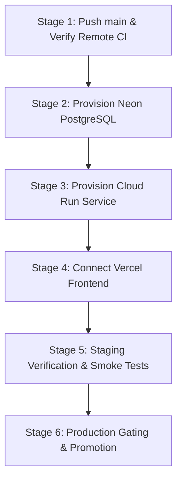

# SentinelLLM — Production Credential & Account Setup Guide

> **Document Status:** Authoritative Operations & Credentials Guide (Milestone 2)  
> **Repository:** `https://github.com/yash-mishraa/SentinelLLM`  
> **Target Version:** `v1.0.0-rc.1`

---

## 1. Core Principles & Architecture Boundary

1. **Zero Mandatory Paid LLM Dependencies:** SentinelLLM operates as a deterministic security runtime and Policy Enforcement Point (PEP). It ships with an offline `FakeLLMAdapter` that executes all policy validations, canary leak checks, and PromptProbe attack benchmarks locally without any paid API keys (OpenAI, Anthropic, Gemini).
2. **Strict Server-Side Boundary:** No privileged API keys or database connection strings are ever bundled into client-side JavaScript. The Next.js BFF proxy (`/api/backend/...`) resolves backend API keys strictly in server-side Route Handlers.
3. **Environment Isolation:** Staging and production credentials must remain completely separate. Never reuse staging database URLs or API keys in production.
4. **Fail-Closed Security:** In production mode (`SENTINELLLM_ENV=production`), the application strictly rejects default development keys and terminates startup immediately if credentials are missing or insecure.

---

## 2. Definitive Credential Inventory & Generation Runbook

### Credential 1: Application Role API Keys
*SentinelLLM uses role-based API keys to authenticate callers and enforce granular permissions.*

* **Required For:** Backend gateway startup and role authorization (`admin`, `supervisor`, `analyst`, `guest`).
* **Service / Account:** Self-generated cryptographic secrets.
* **Exact Variable Names:**
  * `SENTINELLLM_ADMIN_KEY`: Wildcard permissions (`*`). Required for benchmark execution, tool administration, and full gateway access.
  * `SENTINELLLM_SUPERVISOR_KEY`: Approvals management (`approvals:manage`) and audit log inspection (`audit:read`).
  * `SENTINELLLM_ANALYST_KEY`: Inspection (`inspect:run`), authorization (`authorize:run`), and simulated records access.
  * `SENTINELLLM_GUEST_KEY`: Unauthenticated / read-only inspection probe access.
* **Generation Process:** Generate four independent 32+ character hex strings:
  ```bash
  # Generate cryptographically secure role API keys
  openssl rand -hex 24 # For ADMIN_KEY
  openssl rand -hex 24 # For SUPERVISOR_KEY
  openssl rand -hex 24 # For ANALYST_KEY
  openssl rand -hex 24 # For GUEST_KEY
  ```
* **Destination:**
  1. Google Cloud Run (as environment variables or via Google Secret Manager).
  2. Vercel Project Settings (Environment Variables for Production & Preview).
  3. GitHub Repository Secrets (for `deploy.yml` automated smoke testing).
* **Environment Separation:** **Yes.** Use distinct keys for staging and production.
* **Safe Validation:** Test without exposing keys:
  ```bash
  curl -s -o /dev/null -w "%{http_code}" -H "X-API-Key: $SENTINELLLM_ADMIN_KEY" https://<backend-url>/api/v1/tools
  # Expected: 200
  ```
* **Rotation & Expiration:** Store key hashes; keys can be rotated without database migrations by updating the environment variables and restarting the container.

---

### Credential 2: Frontend Session Signing Secret (`SESSION_SECRET`)
*Used by the Next.js BFF server to sign and verify HMAC-SHA256 session cookies.*

* **Required For:** Next.js web application session management and role-switching.
* **Service / Account:** Self-generated cryptographic secret.
* **Exact Variable Name:** `SESSION_SECRET`
* **Generation Process:**
  ```bash
  openssl rand -hex 32 # 64-character entropy string
  ```
* **Destination:** Vercel Dashboard $\to$ Project Settings $\to$ Environment Variables (Production & Preview).
* **Environment Separation:** **Yes.** Distinct secrets for staging and production.
* **Safe Validation:** Switch persona in the deployed web UI (e.g. from Guest to Analyst); verify `sentinelllm_session` cookie is issued with `HttpOnly`, `SameSite=lax`, and `Secure` attributes.
* **Rotation Considerations:** Rotating `SESSION_SECRET` invalidates active user sessions gracefully, prompting users to re-select their persona.

---

### Credential 3: Neon PostgreSQL Database Connection (`DATABASE_URL`)
*Primary relational database for approval persistence, audit telemetry, rate-limiting, and benchmark history.*

* **Required For:** Backend container persistence and Alembic migrations.
* **Service / Account:** Neon PostgreSQL (`https://console.neon.tech`).
* **Exact Process to Obtain:**
  1. Log in to `console.neon.tech`.
  2. Create a Project named `sentinelllm` (PostgreSQL 16).
  3. Under **Databases**, create `sentinelllm_staging` and `sentinelllm_prod`.
  4. Under **Connection Details**, ensure **Connection pooling** is set to **Direct** (unpooled).
  5. Copy the connection string format:
     `postgresql://[user]:[password]@[endpoint].region.aws.neon.tech/[dbname]?sslmode=require`
* **Exact Variable Name:** `DATABASE_URL` (or `SENTINELLLM_DATABASE_URL`).
* **Destination:**
  1. Google Cloud Run service environment variables.
  2. GitHub Repository Secrets (`staging` and `production` environments) for Alembic migration jobs.
* **Environment Separation:** **Strictly Mandatory.** Staging must point to `sentinelllm_staging`; production must point to `sentinelllm_prod`.
* **Safe Validation:**
  ```bash
  export DATABASE_URL="<connection-string>"
  python scripts/migrate.py current
  ```
* **Quotas & Cost Caveats:** Neon Free Tier includes 0.5 GB storage and auto-suspending compute endpoints (sleeps after 5 minutes of inactivity). SentinelLLM's `pool_pre_ping=True` handles the 1.5–3s wake-up latency seamlessly.

---

### Credential 4: Google Cloud Service Account Key (`GCP_SA_KEY`)
*Used by GitHub Actions to deploy container updates to Cloud Run.*

* **Required For:** Automated CI/CD deployment pipeline (`deploy.yml`).
* **Service / Account:** Google Cloud Console (`https://console.cloud.google.com`).
* **Exact Process to Obtain:**
  1. Open Google Cloud Console $\to$ **IAM & Admin** $\to$ **Service Accounts**.
  2. Create Service Account: `github-deployer`.
  3. Grant Roles:
     - `Cloud Run Admin` (`roles/run.admin`)
     - `Service Account User` (`roles/iam.serviceAccountUser`)
  4. Click the created Service Account $\to$ **Keys** tab $\to$ **Add Key** $\to$ **Create new key (JSON)**.
  5. Download the JSON key file.
* **Exact Variable Name:** `GCP_SA_KEY`
* **Destination:** GitHub Repository Settings $\to$ **Secrets and variables** $\to$ **Actions** $\to$ Environment Secrets (`staging` and `production`).
* **Environment Separation:** Can use one service account with access to both staging and prod Cloud Run services, or separate service accounts for strict least privilege.
* **Safe Validation:** Tested automatically during GitHub Actions `google-github-actions/auth` step.

---

### Credential 5: Vercel Deployment Automation Token (`VERCEL_TOKEN`)
*Used by GitHub Actions for automated pre-built deployments to Vercel.*

* **Required For:** Headless deployment from GitHub Actions. *(Optional if using Vercel's native GitHub integration).*
* **Service / Account:** Vercel (`https://vercel.com/account/tokens`).
* **Exact Process to Obtain:**
  1. Open Vercel $\to$ Account Settings $\to$ **Tokens**.
  2. Create Token named `github-actions-sentinelllm` with Full Account scope.
  3. Obtain `VERCEL_ORG_ID` and `VERCEL_PROJECT_ID` from Project Settings $\to$ General in Vercel.
* **Exact Variable Names:** `VERCEL_TOKEN`, `VERCEL_ORG_ID`, `VERCEL_PROJECT_ID`.
* **Destination:** GitHub Repository Secrets and Variables.
* **Alternative (Recommended):** Connect the GitHub repository directly inside Vercel Dashboard (**Settings -> Git**). Vercel deploys automatically on push without requiring personal access tokens or project IDs in GitHub Secrets.

---

### Credential 6: Optional Live LLM Provider (`OPENAI_API_KEY`)
*Enables optional live frontier model calls for hybrid evaluations.*

* **Required For:** **Optional only.** Live model evaluations via `OpenAICompatibleAdapter`.
* **Service / Account:** OpenAI Platform (`https://platform.openai.com/api-keys`).
* **Default Status:** **Disabled.** SentinelLLM uses `FakeLLMAdapter` by default with zero network calls and zero cost.
* **Exact Variable Name:** `OPENAI_API_KEY` (configured on adapter via `api_key_env_var`).
* **Safe Usage:**
  - Requires explicit opt-in: `--live-opt-in` CLI flag or `live_opt_in=True` in `LLMConfig`.
  - Constrained by strict financial ceilings ($0.20 default budget, $1.00 hard limit).

---

## 3. Step-by-Step Staged Setup Sequence



### Stage 1: Push Branch & Run CI (Zero Cost / Zero Credentials)
1. Verify local Git status: `nothing to commit, working tree clean`.
2. Push branch to remote:
   ```bash
   git push origin main
   ```
3. Confirm CI checks pass on GitHub: **Actions -> CI Quality Gate**.

### Stage 2: Create Neon PostgreSQL Databases
1. Create Neon account $\to$ New Project `sentinelllm`.
2. Create `sentinelllm_staging` and `sentinelllm_prod`.
3. Copy direct connection strings.

### Stage 3: Deploy Cloud Run Backend Container
1. Build and push container or deploy via Google Cloud Run console.
2. Set environment variables (`DATABASE_URL`, `SENTINELLLM_ENV=staging`, role API keys).
3. Set Ingress to *Allow all traffic* and *Allow unauthenticated invocations*.
4. Verify `/healthz` and `/readyz` return HTTP 200.

### Stage 4: Connect Vercel Web Dashboard
1. Import `SentinelLLM` into Vercel with root directory set to `web`.
2. Set environment variables (`SENTINELLLM_API_URL` pointing to Cloud Run, `SESSION_SECRET`, role API keys).
3. Deploy and verify live HTTPS dashboard.

### Stage 5: Configure Protected Environments & Promote to Production
1. In GitHub Repository $\to$ **Settings -> Environments -> production**:
   - Enable **Required reviewers** $\to$ Select your username.
2. In Google Cloud Run:
   - Create production service `sentinelllm-api` with `sentinelllm_prod` database connection.
3. In Vercel:
   - Link production domain/URL.
4. Promote with explicit confirmation `confirm_production: "DEPLOY-PROD"`.
