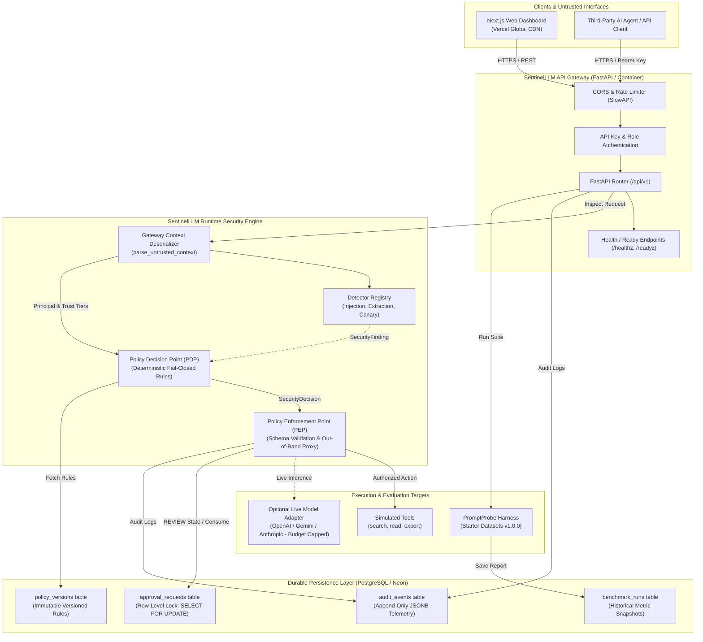
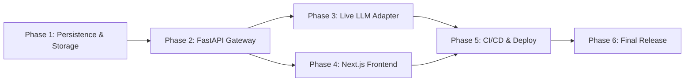

# SentinelLLM — Comprehensive Project Completion Plan

> **Target Version:** SentinelLLM v1.0.0 (Public Production Release)
> **Status:** Final Architecture & Implementation Roadmap (Planning Phase)
> **Author:** SentinelLLM Core Security & Engineering Team
> **Repository:** `https://github.com/yash-mishraa/SentinelLLM`
> **Commit Verified:** `7eca1577d5652cb7b68d89f94b36bbf086017487`

---

## Executive Summary

SentinelLLM is an open-source, defense-in-depth security framework for Large Language Model (LLM) applications and autonomous AI agents. Its central architectural thesis is the **decoupling of probabilistic content inspection from deterministic action-level policy enforcement**.

Over Milestones 1 through 10, the core Python security engine was built, audited, hardened, benchmarked via PromptProbe (23 synthetic single-cases, 10 multi-step scenarios), verified with 160 unit/adversarial tests (95.47% branch coverage), and packaged with a 6-stage deterministic CLI demonstration.

This document outlines the master completion plan to evolve SentinelLLM from a verified core engine and CLI harness into a **fully deployed, publicly demonstrable cybersecurity SaaS and research platform**. The target release includes:
1. **Durable Enterprise Gateway:** A high-throughput, async FastAPI REST backend with PostgreSQL persistence, row-level atomic approval locking, Alembic schema migrations, and API key authentication.
2. **Cybersecurity Operations Dashboard:** A responsive Next.js 15 (React 19 / TypeScript) web application utilizing Tailwind CSS, shadcn/ui, and Recharts, providing an interactive adversarial attack playground, live approval queue, telemetry explorer, and benchmark visualizer.
3. **Reproducible Evaluation & Live-Model Harness:** Enhanced PromptProbe with optional provider-based live model testing under strict budget ceilings ($0.20 cap) alongside zero-cost synthetic baselines.
4. **Automated CI/CD & Production Infrastructure:** Multi-environment GitHub Actions workflows deploying the backend to containerized hosting (Fly.io/Railway/Cloud Run), managed PostgreSQL (Neon), and the frontend to Vercel.

---

## 1. Current-State Audit (Verified Baseline)

An exhaustive inspection of the repository at commit `7eca157` verifies the following implemented components, file locations, and test results:

### 1.1 Core Engine (`src/sentinelllm/`)
- **Typed Security Contracts (`src/sentinelllm/contracts/`):**
  - [`provenance.py`](file:///Users/yashmishra14/Personal%20projects/SentinelLLM/src/sentinelllm/contracts/provenance.py): Immutable `ContentProvenance` (`APPLICATION_INSTRUCTION`, `USER_MESSAGE`, `RETRIEVED_DOCUMENT`, `EXTERNAL_TOOL`) and `TrustClassification` (`TRUSTED_INSTRUCTIONS`, `USER_INPUT`, `UNTRUSTED_CONTEXT`) with strict authority invariant validation (`assert_valid_trust_binding`).
  - [`messages.py`](file:///Users/yashmishra14/Personal%20projects/SentinelLLM/src/sentinelllm/contracts/messages.py): Typed message models (`UserMessage`, `RetrievedChunk`, `ToolOutput`) and ingestion deserializer [`parse_untrusted_content()`](file:///Users/yashmishra14/Personal%20projects/SentinelLLM/src/sentinelllm/contracts/messages.py#L55-L100) preventing untrusted inputs from acquiring `APPLICATION_INSTRUCTION` provenance.
  - [`context.py`](file:///Users/yashmishra14/Personal%20projects/SentinelLLM/src/sentinelllm/contracts/context.py): Validated `RequestContext` and anti-spoofing gateway parser [`parse_untrusted_context()`](file:///Users/yashmishra14/Personal%20projects/SentinelLLM/src/sentinelllm/contracts/context.py#L65-L100) that strips caller-asserted authenticated identities and privileged roles.
  - [`decision.py`](file:///Users/yashmishra14/Personal%20projects/SentinelLLM/src/sentinelllm/contracts/decision.py): `SecurityFinding` (probabilistic observation with category and `Severity`) and `SecurityDecision` (deterministic verdict: `ALLOW`, `BLOCK`, `REVIEW`, `REDACT`).
  - [`audit.py`](file:///Users/yashmishra14/Personal%20projects/SentinelLLM/src/sentinelllm/contracts/audit.py): `AuditEvent` with recursive key-sanitization scanning nested dictionaries and tuples for credentials (`token`, `password`, `auth`, `private_key`).
- **Detection Subsystem (`src/sentinelllm/detectors/`):**
  - Modular `BaseDetector` and [`DetectorRegistry`](file:///Users/yashmishra14/Personal%20projects/SentinelLLM/src/sentinelllm/detectors/registry.py).
  - [`InjectionPatternDetector`](file:///Users/yashmishra14/Personal%20projects/SentinelLLM/src/sentinelllm/detectors/injection.py): Regex heuristic rules `INJ_001` through `INJ_004` matching imperative instruction overrides, persona jailbreaks, delimiter clashes, and prompt dumping.
  - [`InstructionExtractionDetector`](file:///Users/yashmishra14/Personal%20projects/SentinelLLM/src/sentinelllm/detectors/extraction.py): Rules `EXT_001` through `EXT_003` detecting system prompt elicitation.
  - [`CanaryLeakDetector`](file:///Users/yashmishra14/Personal%20projects/SentinelLLM/src/sentinelllm/detectors/canary.py): Detects synthetic canary token exposure, reporting stable canary IDs without revealing secrets.
- **Policy Engine (PDP) (`src/sentinelllm/policy/`):**
  - [`principal.py`](file:///Users/yashmishra14/Personal%20projects/SentinelLLM/src/sentinelllm/policy/principal.py): Immutable `AuthenticatedPrincipal` and `AnonymousPrincipal`.
  - [`engine.py`](file:///Users/yashmishra14/Personal%20projects/SentinelLLM/src/sentinelllm/policy/engine.py): `PolicyDecisionPoint` implementing fail-closed deterministic evaluation order: missing identity check -> critical canary containment -> rule matching (permissions/roles) -> high-risk finding containment (`Severity.HIGH`) -> review/approval evaluation.
- **Policy Enforcement Point (PEP) & Tools (`src/sentinelllm/tools/`):**
  - [`pep.py`](file:///Users/yashmishra14/Personal%20projects/SentinelLLM/src/sentinelllm/tools/pep.py): Intercepts tool calls out-of-band, validates Pydantic argument schemas, redacts raw secrets from validation errors via `_sanitize_validation_error()`, gates execution against PDP decisions, integrates with `ApprovalService`, and executes tools with exception containment.
  - [`registry.py`](file:///Users/yashmishra14/Personal%20projects/SentinelLLM/src/sentinelllm/tools/registry.py) & [`simulated.py`](file:///Users/yashmishra14/Personal%20projects/SentinelLLM/src/sentinelllm/tools/simulated.py): Synthetic zero-side-effect tools (`search_documents`, `read_customer_record`, `export_customer_records`).
- **Human Approval Workflow (`src/sentinelllm/approvals/`):**
  - [`models.py`](file:///Users/yashmishra14/Personal%20projects/SentinelLLM/src/sentinelllm/approvals/models.py): States `PENDING`, `APPROVED`, `REJECTED`, `EXPIRED`, `CONSUMED`. Cryptographic SHA-256 argument binding (`compute_argument_hash`).
  - [`service.py`](file:///Users/yashmishra14/Personal%20projects/SentinelLLM/src/sentinelllm/approvals/service.py) & [`store.py`](file:///Users/yashmishra14/Personal%20projects/SentinelLLM/src/sentinelllm/approvals/store.py): `ApprovalService` synchronized via `threading.RLock()` guaranteeing atomic single-use consumption.
- **Lifecycle Orchestrator (`src/sentinelllm/orchestrator.py`):**
  - Coordinates ingestion, detector scanning, and audit event generation into `LifecycleResult`.
- **End-to-End Portfolio Demo (`src/sentinelllm/demo.py`, `scripts/demo.py`):**
  - 6-stage deterministic walkthrough verifying direct injection, indirect RAG injection, unauthorized tool denial, pending approval, authorized execution, and tampered request/replay rejection.

### 1.2 Evaluation Suite (`promptprobe/`)
- [`dataset.py`](file:///Users/yashmishra14/Personal%20projects/SentinelLLM/promptprobe/dataset.py), [`models.py`](file:///Users/yashmishra14/Personal%20projects/SentinelLLM/promptprobe/models.py), [`scenario_models.py`](file:///Users/yashmishra14/Personal%20projects/SentinelLLM/promptprobe/scenario_models.py): Validates JSON datasets.
- [`starter_adversarial_v1.json`](file:///Users/yashmishra14/Personal%20projects/SentinelLLM/benchmarks/datasets/starter_adversarial_v1.json): 23 single cases across 12 attack/baseline categories.
- [`starter_scenarios_v1.json`](file:///Users/yashmishra14/Personal%20projects/SentinelLLM/benchmarks/datasets/starter_scenarios_v1.json): 10 multi-step ordered scenario traces (28 steps).
- [`runner.py`](file:///Users/yashmishra14/Personal%20projects/SentinelLLM/promptprobe/runner.py), [`scenario_runner.py`](file:///Users/yashmishra14/Personal%20projects/SentinelLLM/promptprobe/scenario_runner.py), [`metrics.py`](file:///Users/yashmishra14/Personal%20projects/SentinelLLM/promptprobe/metrics.py): Confusion matrix calculation and enforcement accuracy.
- **Verified Benchmark Scores:**
  - Single-case: 22/23 passed specification (93.75% accuracy, 87.5% recall, 100% enforcement accuracy with 0 unauthorized executions; 1 expected FN on `INJ-DIR-002`).
  - No-detection baseline: 0% recall, 100% enforcement accuracy (0 unauthorized executions).
  - Scenarios: 10/10 passed (100% pass rate, 0 unauthorized executions, 0 provenance violations).

### 1.3 Quality Gates & CI (`tests/`, `.github/workflows/ci.yml`)
- 160 automated tests in `tests/unit/` with **95.47% branch coverage**.
- Ruff (v0.17.2 local / v0.5.5 pre-commit) and Mypy strict mode passing cleanly across 54 source files.
- GitHub Actions CI workflow executing multi-version matrix across Python 3.12 and 3.13.

---

## 2. Gap Analysis (What is Missing for a Public Product)

| Dimension | Current State | Production Product Requirement | Gap & Risk Severity |
| :--- | :--- | :--- | :--- |
| **API Exposure** | CLI only (`python -m sentinelllm.demo`, `promptprobe`) | Async REST API (FastAPI) with OpenAPI contracts, structured error schemas, CORS, and health endpoints. | **HIGH**: External consumers or web frontends cannot interface with SentinelLLM over HTTP. |
| **Concurrency & Store** | `InMemoryApprovalStore` protected by `threading.RLock()` | Persistent PostgreSQL storage with row-level locks (`SELECT ... FOR UPDATE`) or atomic transactional scripts. | **HIGH**: Multi-worker (e.g. Uvicorn `--workers 4`) or multi-container deployments will experience race conditions and approval replay. |
| **Audit Persistence** | In-memory `AuditEvent` tuples returned in memory; zero durable storage | Searchable, append-only PostgreSQL audit table with JSONB indexing and query endpoints. | **MEDIUM**: Telemetry is lost upon process termination. |
| **Policy Configuration** | In-code `DEFAULT_POLICY_RULES` tuple | Dynamic policy configuration with database or environment-backed versioning. | **MEDIUM**: Rule changes require code edits rather than administrative updates. |
| **Web Dashboard** | None (terminal text output only) | Responsive Next.js cybersecurity operations dashboard with live playground, approval queue, telemetry explorer, and metrics. | **HIGH**: Essential for technical portfolio presentation, executive review, and live user demonstration. |
| **Authentication & IAM** | Memory-constructed `AuthenticatedPrincipal` | API Key authentication and role-based access control (RBAC) separating callers, analysts, and supervisors. | **HIGH**: Public web endpoints would otherwise be unprotected against abuse. |
| **Rate Limiting** | None | IP and API-key rate limiting (SlowAPI) to prevent denial-of-service and brute-force token exhaustion. | **MEDIUM**: Vulnerable to traffic surges or malicious fuzzing. |
| **Live Model Evaluation** | Simulated mock responses only | Optional provider adapter (OpenAI / Anthropic / Gemini / Ollama) with strict budget ceilings ($0.20 cap) to test live LLMs. | **LOW / MEDIUM**: Synthetic tests are strictly reproducible, but evaluating a live model provides stronger demonstration evidence. |
| **Container & Cloud Deployment** | Local virtualenv and Make targets | Containerized Docker packaging, automated cloud deployment (Cloud Run / Railway / Fly.io), and Vercel hosting. | **HIGH**: External reviewers cannot test without cloning and setting up Python locally. |

---

## 3. Target Architecture & Component Flow



### 3.1 Recommended Technology Stack

1. **Backend Engine & API:**
   - **Framework:** FastAPI (Python 3.12+, async, native Pydantic v2 integration).
   - **ASGI Server:** Uvicorn (multi-worker production configuration).
   - **Database ORM:** SQLAlchemy 2.0 (asyncio + asyncpg driver) with Alembic for automated migrations.
   - **Validation & Serialization:** Pydantic v2 (leveraging existing contracts).
   - **Rate Limiting:** SlowAPI (in-memory token bucket for single instance, Redis-ready).
2. **Persistence (PostgreSQL):**
   - **Provider:** Managed serverless PostgreSQL via Neon (free tier: 0.5 GB storage, autoscaling, branchable).
   - **Fallback:** SQLite async driver (`aiosqlite`) for zero-dependency local testing.
3. **Frontend Dashboard:**
   - **Framework:** Next.js 15 (App Router, React 19, TypeScript).
   - **Styling & Components:** Tailwind CSS, shadcn/ui (Radix UI primitives), Lucide React icons.
   - **Data Visualization:** Recharts (confusion matrices, time-series intercept telemetry, accuracy comparisons).
   - **HTTP Client:** TanStack Query (React Query) + native `fetch` with typed API contracts.
   - **Aesthetic:** Dark cybersecurity console (obsidian/slate background, emerald/amber/rose status badges, monospace telemetry panels).
4. **Cloud Infrastructure & Hosting:**
   - **Backend API Container:** Cloud Run (Google Cloud free tier) or Fly.io / Railway container hosting.
   - **Frontend Application:** Vercel (Hobby free tier with edge caching and automatic preview branches).
   - **Database:** Neon PostgreSQL (Serverless free tier).

---

## 4. Comprehensive Security Review & Invariants

### 4.1 Distributed Concurrency & TOCTOU Elimination
- **Risk:** In-memory `RLock` in `ApprovalService` cannot prevent double-spending across multiple Uvicorn worker processes or container replicas.
- **Remediation:** Implement `PostgresApprovalStore` using PostgreSQL row-level locks:
  ```sql
  SELECT * FROM approval_requests WHERE approval_id = :id FOR UPDATE;
  ```
  Transitions from `APPROVED` to `CONSUMED` occur within an explicit ACID transaction. If `status != 'APPROVED'`, the transaction rolls back and returns `REASON_DENY_APPROVAL_ALREADY_CONSUMED`.

### 4.2 Ingestion & Trust-Boundary Guarantees
- The FastAPI gateway must never trust client-supplied identity claims. All incoming HTTP requests authenticate via `Authorization: Bearer <API_KEY>`.
- The gateway parses request bodies exclusively using [`parse_untrusted_context()`](file:///Users/yashmishra14/Personal%20projects/SentinelLLM/src/sentinelllm/contracts/context.py#L65-L100). Any attempt to pass `ApplicationInstruction`, declare `TRUSTED_INSTRUCTIONS`, or assert `AuthenticatedPrincipal` in JSON payloads is rejected at the deserialization boundary.

### 4.3 Error Redaction & Information Disclosure
- Validation errors produced by Pydantic on tool execution arguments must pass through [`_sanitize_validation_error()`](file:///Users/yashmishra14/Personal%20projects/SentinelLLM/src/sentinelllm/tools/pep.py#L22-L34), returning only field locations and error codes while strictly excluding input values.
- Audit records written to the database pass through [`_scan_keys_recursively()`](file:///Users/yashmishra14/Personal%20projects/SentinelLLM/src/sentinelllm/contracts/audit.py#L40-L65), preventing passwords, tokens, or private keys from persisting in logs.

### 4.4 Rate Limiting & Denial-of-Service Defense
- Unauthenticated or client-facing playground endpoints must be rate-limited (e.g. 30 requests/minute per IP) using SlowAPI.
- Request payload sizes are capped at 64 KB to mitigate regex ReDoS or memory exhaustion.

---

## 5. Implementation Roadmap & Phased Milestones



### Phase 1: Database Persistence & Distributed Approval Store
- **Deliverables:**
  - Database schema definitions (SQLAlchemy 2.0 models) for `approval_requests`, `audit_events`, `policy_versions`, and `benchmark_runs`.
  - Alembic migration setup with automatic version tracking.
  - `PostgresApprovalStore` implementing atomic row-level locking (`FOR UPDATE`).
  - Unit and integration tests verifying concurrency across simulated multi-connection database transactions.
  - Zero-config SQLite fallback for local developer setups (`USE_SQLITE=true`).

### Phase 2: FastAPI Application & REST Gateway
- **Deliverables:**
  - `src/sentinelllm/api/` application package with modular routers:
    - `/api/v1/inspect`: Context ingestion and detector scanning.
    - `/api/v1/authorize`: Action policy evaluation via PDP.
    - `/api/v1/execute`: Out-of-band tool proxying via PEP.
    - `/api/v1/approvals`: Approval review and atomic consumption lifecycle.
    - `/api/v1/audit`: Searchable audit trail querying.
    - `/api/v1/benchmark`: Triggering PromptProbe benchmark and scenario runs.
  - API Key authentication dependency (`get_current_principal`).
  - SlowAPI rate-limiting middleware.
  - Comprehensive OpenAPI documentation (Swagger UI at `/docs`).
  - Pytest API test suite (`TestClient` / `httpx`).

### Phase 3: Optional Live LLM Adapter & Hybrid Evaluation
- **Deliverables:**
  - `src/sentinelllm/adapters/llm.py`: Pluggable model interface supporting OpenAI, Anthropic, Gemini, and local Ollama.
  - Hardened budget constraints: hard ceiling token counter, default disabled, max $0.20 per benchmark run, requiring explicit API key environment variable.
  - PromptProbe extension comparing synthetic scores vs. live model behavior against identical injection payloads.

### Phase 4: Next.js Cybersecurity Operations Dashboard
- **Deliverables:**
  - `web/` application directory with Next.js 15, Tailwind CSS, shadcn/ui, and TypeScript.
  - **Interception Playground:** Live visual input scanner showing prompt tagging, detector flags, PDP verdicts, and PEP gating.
  - **Approval Queue:** Real-time table of pending requests with countdown timers and supervisor approve/reject controls.
  - **Audit Explorer:** Searchable, paginated audit telemetry table with JSON payload inspector.
  - **PromptProbe Visualizer:** Interactive confusion matrix, baseline comparison graphs, and scenario execution drill-downs.
  - **Guided Demo Tour:** Step-by-step interactive walkthrough mirroring the 6-stage demo.

### Phase 5: CI/CD Pipelines & Cloud Deployment
- **Deliverables:**
  - Production multi-stage `Dockerfile` for the Python backend.
  - GitHub Actions deployment workflows for:
    - Backend deployment to container service (Cloud Run / Railway / Fly.io).
    - Database migration runner via Alembic during deployment.
    - Frontend deployment to Vercel.
  - Environment separation (`development`, `staging`, `production`).
  - Automated smoke tests executing against deployed staging URLs prior to traffic promotion.

### Phase 6: Documentation, Portfolio Assets & Final Release
- **Deliverables:**
  - Public documentation site / README updates featuring live demo URLs and architecture diagrams.
  - Recorded terminal and UI walkthroughs (SVG/GIF artifacts).
  - CV / Portfolio showcase section with exact verified metrics.
  - Final security audit update reflecting the live deployed architecture.

---

## 6. Concrete Acceptance Criteria per Phase

- **Phase 1 Acceptance:**
  - 10 concurrent database transactions attempting to consume the same approval ID in PostgreSQL yield exactly 1 success and 9 `DENY_APPROVAL_ALREADY_CONSUMED` rejections.
  - Alembic migrations apply cleanly from empty database to latest revision (`alembic upgrade head`).
- **Phase 2 Acceptance:**
  - 100% of API endpoints return strict Pydantic-validated responses with accurate HTTP status codes (200, 400, 401, 403, 404, 429).
  - Unauthenticated requests to protected endpoints return 401 Unauthorized.
  - Invalid arguments passed to `/execute` return redacted schema validation errors with 0 echoed secrets.
- **Phase 3 Acceptance:**
  - Live model adapter terminates immediately with an error if API spend exceeds configured dollar threshold ($0.20).
  - Synthetic PromptProbe benchmark runs cleanly without network calls when provider keys are omitted.
- **Phase 4 Acceptance:**
  - Next.js web build succeeds with zero TypeScript or ESLint errors (`npm run build`).
  - Playground accurately displays findings, PDP decisions, and PEP execution for user-entered text.
  - Approving a request in the web UI immediately enables execution in the PEP and marks the request `CONSUMED`.
- **Phase 5 Acceptance:**
  - GitHub Actions workflow builds Docker container, passes all tests, applies migrations, and deploys without downtime.
  - Health endpoint (`/healthz`) returns HTTP 200 on live deployment.

---

## 7. Testing Strategy

```text
tests/
├── unit/                        # 160 existing tests (95%+ coverage)
├── integration/
│   ├── test_postgres_store.py   # Row-level lock concurrency & transaction rollback
│   ├── test_api_inspect.py      # /api/v1/inspect contracts and detection
│   ├── test_api_pep.py          # /api/v1/execute gating, schema errors, and secrets
│   ├── test_api_approvals.py    # Approval creation, review, and atomic consumption
│   └── test_api_audit.py        # Telemetry ingestion and recursive key redaction
├── e2e/
│   ├── test_e2e_walkthrough.py  # End-to-end multi-step flow via HTTP client
│   └── playwright/              # Web dashboard UI smoke tests (Playwright)
└── security/
    ├── test_dos_rate_limit.py   # Rate limiting and payload size guards
    └── test_token_tampering.py  # Replay and argument digest modification
```

---

## 8. CI/CD & Release Strategy

1. **Pull Request Quality Gate:**
   - Pre-commit hooks (`trailing-whitespace`, `check-yaml`, `ruff`, `mypy`).
   - Pytest unit and integration test suite with coverage enforcement (min 80%).
   - Next.js typecheck and build validation.
2. **Staging Continuous Deployment:**
   - Automatic build of container image on push to `main`.
   - Run Alembic database migrations against staging Neon branch.
   - Deploy container to staging environment.
   - Run live smoke test suite against staging URL.
3. **Production Release:**
   - Tagged release (`v1.0.0`) triggers deployment to production container service and Vercel production domain.
   - Zero-downtime rolling restart with health check verification (`/healthz`).
   - Automated rollback if health checks fail within 120 seconds.

---

## 9. Cost, Infrastructure & Dependency Estimates

| Resource / Service | Provider | Purpose | Estimated Monthly Cost | Account / Setup Required |
| :--- | :--- | :--- | :--- | :--- |
| **Backend API Hosting** | Google Cloud Run / Railway / Fly.io | Containerized FastAPI backend | **$0.00** (Free tier covers ~2M requests/month) | Account registration + CLI authentication |
| **PostgreSQL Database** | Neon (Serverless Postgres) | Durable approvals, audit, metrics | **$0.00** (Free tier: 0.5 GB, autoscaling, 1 project) | Neon account + database connection string |
| **Frontend Web Hosting** | Vercel | Next.js dashboard & global CDN | **$0.00** (Hobby free tier) | Vercel account linked to GitHub repository |
| **Live LLM Testing** | OpenAI / Gemini API (Optional) | Live adversarial model probes | **<$0.50** (Capped budget ceiling for evaluation) | Optional API key supplied by user |
| **Continuous Integration** | GitHub Actions | Automated lint, test, build, deploy | **$0.00** (Free for public repositories) | Existing GitHub repository |
| **Total Estimated Operating Cost** | | | **$0.00 – $1.00 / month** | |

---

## 10. Risk Register

| Risk ID | Risk Description | Severity | Likelihood | Mitigation Strategy | Residual Risk |
| :--- | :--- | :--- | :--- | :--- | :--- |
| **RSK-01** | Multi-worker approval double-spending in deployed container | **CRITICAL** | High | PostgreSQL row-level locking (`SELECT ... FOR UPDATE`) within atomic transaction. | Process requires operational database connection. |
| **RSK-02** | Secret leakage in audit logs or API exception responses | **HIGH** | Medium | Centralized sanitizers (`_sanitize_validation_error`, `_scan_keys_recursively`). | Novel third-party payload formats requiring new patterns. |
| **RSK-03** | Public API abuse / DoS via recursive prompt evaluations | **MEDIUM** | High | SlowAPI rate limiting (30 req/min/IP) and 64 KB request payload size ceiling. | Distributed botnets bypassing IP rate limits. |
| **RSK-04** | Live LLM API cost overrun during automated evaluations | **MEDIUM** | Low | Hard token counter and strict dollar budget ceiling ($0.20 cap). | Requires valid user-supplied API key. |
| **RSK-05** | Public perception of universal prompt-injection defense | **HIGH** | Medium | Prominent disclaimers, transparent reporting of `INJ-DIR-002`, and threat model emphasis on action containment over content detection. | Users assuming regex filters guarantee 100% security. |

---

## 11. Definition of Done (v1.0.0 Release Checklist)

- [x] **Core Engine:** All existing contracts, detectors, PDP, PEP, approvals, and PromptProbe suites preserved with 0 regressions.
- [x] **Persistence:** PostgreSQL schema and Alembic migrations fully implemented and tested.
- [x] **FastAPI Gateway:** All `/api/v1` routes documented, validated, and covered by integration tests.
- [x] **Frontend Dashboard:** Next.js 15 application built, styled, and responsive across desktop and mobile in `web/`.
- [x] **Interactive Playground:** Functional web UI demonstrating real-time injection detection and PEP gating.
- [x] **Approval Queue:** Web UI allows supervisor review and verifies atomic consumption.
- [x] **Quality Gates:** 100% type safety (`mypy --strict`), Ruff linting/formatting, Next.js build clean, and >90% test coverage.
- [x] **Evaluation:** PromptProbe results visualizable in UI and reproducible via CLI.
- [x] **Packaging & CI/CD Readiness:** Production multi-stage Dockerfile, isolated migration CLI (`scripts/migrate.py`), GitHub Actions CI and deployment pipelines, PostgreSQL 16 service integration tests, and smoke test runner (`scripts/smoke_test.py`).
- [x] **Documentation & Portfolio:** Complete `README.md`, `docs/PORTFOLIO.md`, architectural diagrams, CV showcase section, and honest benchmark scorecards.
- [ ] **Live Cloud Deployment (Optional User Execution):** Provisioning live infrastructure on Fly.io/Cloud Run, Neon PostgreSQL, and Vercel.

---

## Manual Actions Required From Me

### Required now
- **None.** All code, documentation, container definitions, standalone migration tools, CI workflows, and smoke suites run locally and pass all quality gates without requiring active cloud credentials or public deployment.

### Required later (When deploying to live hosting)
1. **Neon PostgreSQL Database Provisioning:**
   - *Action:* Sign up at [neon.tech](https://neon.tech) (free tier), create a project named `sentinelllm-prod`, and copy the PostgreSQL connection string.
   - *Destination:* Set as `DATABASE_URL` in container hosting and GitHub repository secrets.
2. **Backend Container Platform Provisioning:**
   - *Action:* Create an account on Fly.io, Railway, or Google Cloud Run.
   - *Destination:* Connect repository or provide deployment token for GitHub Actions deployment workflow.
3. **Vercel Frontend Hosting Authorization:**
   - *Action:* Import the `SentinelLLM` repository on [vercel.com](https://vercel.com) (Hobby plan) and link the `web/` root directory. Set `SENTINELLLM_API_URL` and `SESSION_SECRET` in Vercel project environment variables.
   - *Destination:* Vercel project dashboard.
4. **Live LLM API Keys (Optional):**
   - *Action:* Supply a Google Gemini or OpenAI API key if live-model evaluation is desired.
   - *Destination:* Set as `GEMINI_API_KEY` in environment secrets (never commit to Git).

### Optional
- **Custom Domain Setup:** Configure a custom domain (e.g. `sentinelllm.dev`) pointing to Vercel and the backend API container.

---

## Next Step

All planned implementation, hardening, packaging, CI/CD, and portfolio documentation phases (Phases 1 through 6) are complete and verified across the codebase.

The recommended next step is:
> **"Final Release Review & Git Tagging: Verify all unstaged changes, review final repository hygiene, and prepare the local v1.0.0 release tag when ready to commit."**
