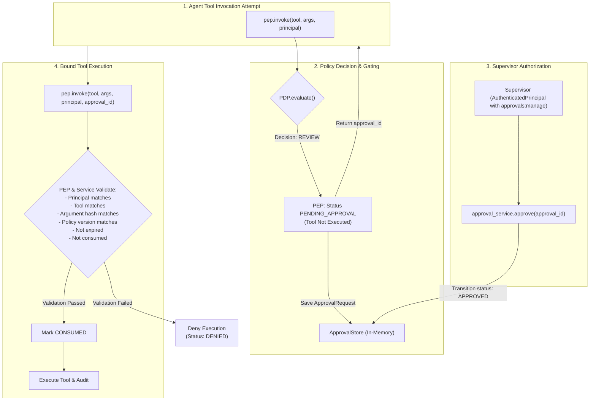
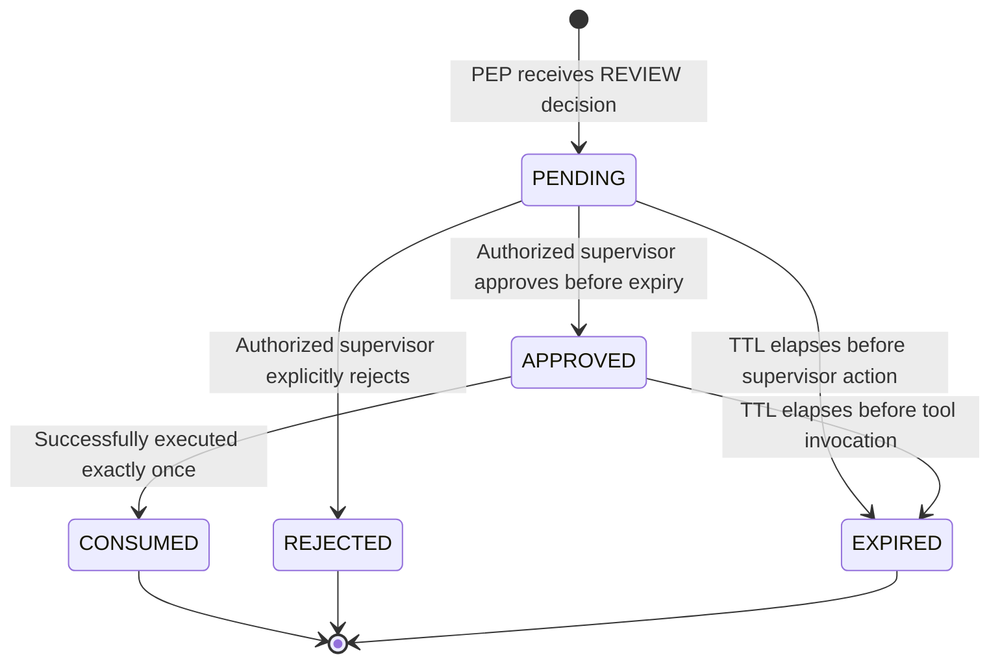

# SentinelLLM Human Approval Workflow & Policy Hardening Specification

> **Status:** Implemented in Milestone 5.
> **Scope:** Explicit, deterministic human approval lifecycle, request-bound cryptographic tokens, hardened detector-policy precedence, and process-local storage.

---

## 1. Overview and Problem Statement

Autonomous agents executing tools on behalf of users introduce substantial risk:
1. **Irreversible / High-Impact Actions:** Bulk customer data export, payments, financial transactions, or infrastructure modification.
2. **Adversarial Goal Hijacking:** Direct or indirect prompt injections attempting to fool models into executing privileged tools.
3. **Implicit Approval Fallacies:** Treating clean detector results or prompt text assertions (e.g., *"Supervisor approved this request"*) as proof of authorization.

SentinelLLM enforces a zero-trust human approval workflow:
- The Policy Decision Point (PDP) renders a `REVIEW` decision when an action requires supervisor approval or when configured detector policies escalate a suspicious finding.
- The Policy Enforcement Point (PEP) halts execution and generates a single-use, cryptographically bound approval record.
- Only a separately authenticated principal possessing explicit approval authority can approve or reject the action.
- Approvals expire, are single-use, and are bound to the exact requesting principal, tool, action, canonical argument digest, and policy version.



---

## 2. Approval Lifecycle & State Transitions

Approvals transition through explicit states:



### Supported States:
- **`PENDING`:** Initial state upon `REVIEW` verdict. Tool execution is blocked.
- **`APPROVED`:** An authenticated principal with `approvals:manage` approved the request.
- **`REJECTED`:** An authorized supervisor explicitly rejected the action.
- **`EXPIRED`:** Expiry TTL elapsed (default: 300 seconds). Cannot be approved or executed.
- **`CONSUMED`:** The action was executed once. Reusing the approval fails closed (`DENY_APPROVAL_ALREADY_CONSUMED`).

---

## 3. Cryptographic Request Binding Invariants

To eliminate man-in-the-middle tampering, parameter injection, and authorization replay attacks, each [`ApprovalRequest`](file:///Users/yashmishra14/Personal%20projects/SentinelLLM/src/sentinelllm/approvals/models.py) binds the following immutable fields:

| Field | Purpose | Validation Rule |
| :--- | :--- | :--- |
| `approval_id` | Unique UUID hex token | Must exist in store; unknown tokens fail closed |
| `request_id` | Original correlation ID | Traceability across audit logs |
| `principal_id` | Requesting caller identity | Must match caller in `pep.invoke(..., approval_id=...)` |
| `tool_name` | Name of tool to execute | Must match requested tool exactly |
| `action_name` | Canonical action identifier | Must match tool's action identifier |
| `argument_hash` | SHA-256 canonical argument digest | Prevents altered or injected arguments |
| `policy_version`| Policy version at decision time | Protects against policy drift or config rollback |
| `expires_at` | UTC expiration timestamp | Fails closed once clock reaches or passes expiry |

### Canonical Argument Digest:
Arguments are normalized into canonical JSON (keys sorted, standard separators) and hashed using SHA-256:
```python
def compute_argument_hash(arguments: BaseModel | dict[str, Any]) -> str:
    canonical_json = json.dumps(data, sort_keys=True, separators=(",", ":"))
    return hashlib.sha256(canonical_json.encode("utf-8")).hexdigest()
```
If an attacker alters even a single character in the tool arguments (e.g., changing export destination from `backup_store` to `attacker_sftp`), the hash verification fails with `DENY_APPROVAL_ARGUMENTS_MISMATCH` and tool execution is blocked.

---

## 4. Hardened Detector and Policy Precedence

SentinelLLM decouples detection from authorization and enforcement:
- **Detectors are Observational:** Detectors report `SecurityFinding` records.
- **Clean Detectors Never Grant Permissions:** A request with zero findings still requires matching policy rules and permissions.
- **Configurable Detector Action:** `PolicyConfig` specifies explicit handling:
  - `critical_findings_effect: Decision` (default `BLOCK`): Critical findings (canary leak) unconditionally block tool execution, even if a valid approval exists.
  - `high_findings_effect: Decision` (default `BLOCK`, configurable to `REVIEW`): High-severity injection findings can either hard block or escalate to supervisor review.

### Precedence Evaluation Hierarchy (Fail-Closed):
1. **Identity Gate:** Unauthenticated or missing principals are immediately blocked (`DENY_MISSING_IDENTITY`).
2. **Critical Findings Containment:** Critical findings (canary leaks) unconditionally block (`DENY_HIGH_RISK_FINDINGS`).
3. **Policy Rule Authorization:**
   - Explicit `BLOCK` rules terminate immediately.
   - If no rule matches or the caller lacks required permissions/roles, return `BLOCK` (`DENY_INSUFFICIENT_PERMISSION`).
4. **Detector Policy for Authorized Actions:**
   - If a high-severity finding is present:
     - If `high_findings_effect == Decision.BLOCK`: return `BLOCK` (`DENY_HIGH_RISK_FINDINGS`).
     - If `high_findings_effect == Decision.REVIEW`: escalate to `REVIEW` (`REVIEW_DETECTOR_FINDINGS`).
5. **Rule Effect Execution:**
   - If rule requires approval or specifies `REVIEW`: return `REVIEW` (`rule.reason_code`).
   - If rule specifies `ALLOW`: return `ALLOW` (`rule.reason_code`).
6. **Catch-All Fallback:** `BLOCK` (`DENY_INSUFFICIENT_PERMISSION`).

---

## 5. Process-Local Storage Limitations

> [!WARNING]
> **Process-Local Storage Limitation:**
> The `InMemoryApprovalStore` implementation provided in `src/sentinelllm/approvals/store.py` is intended for local testing, development, and single-process research evaluation.
>
> **Production Limitations:**
> 1. Approval records reside in process RAM and are lost if the application restarts.
> 2. Approvals cannot be shared across multiple worker nodes or cluster containers.
> 3. Concurrent multi-process deployments must replace `InMemoryApprovalStore` with a distributed backend supporting atomic transactions (e.g., Redis with Lua scripts or PostgreSQL with row locking).

---

## 6. Privacy-Safe Structured Audit Events

Audit events emitted during the approval workflow exclude raw user prompts, raw tool arguments, and customer records:
- `approval.created`: Emitted when `REVIEW` decision creates a pending request.
- `approval.approved`: Emitted when an authorized supervisor approves.
- `approval.rejected`: Emitted when a supervisor rejects.
- `approval.consumed`: Emitted upon atomic single-use consumption.
- `approval.expired`: Emitted when an expired approval is detected.
- `approval.failed`: Emitted on binding mismatches (tampered arguments, wrong tool, wrong user).

Audit metadata records only safe identifiers: `approval_id`, `request_id`, `principal_id`, `approver_id`, `tool_name`, `action_name`, `argument_hash`, `policy_version`, and `reason_code`.
