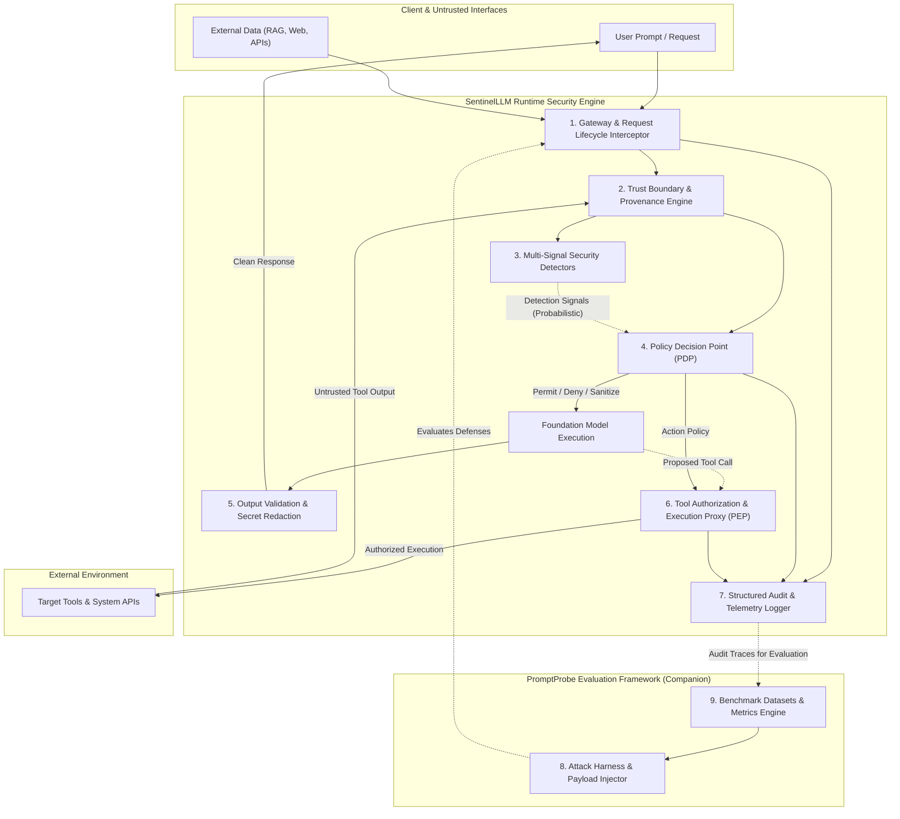

# SentinelLLM System Architecture & Design Specification

> **Architectural Proposal Notice:** This document specifies the planned technical architecture, component boundaries, and security contracts for SentinelLLM and its companion harness PromptProbe. As of Milestone 1 (Foundation), this describes proposed target system capabilities and does not represent completed implementation.

---

## 1. High-Level Architectural Vision

SentinelLLM is designed as a defense-in-depth, runtime security framework for applications built on large language models (LLMs) and autonomous AI agents. Rather than relying solely on probabilistic content filtering or prompt-level admonitions, SentinelLLM decouples **probabilistic signal detection** from **deterministic action-level policy enforcement**.

---

## 2. Core Architectural Components & Separation of Concerns

### 2.1 Gateway and Request Lifecycle
The Gateway intercepts inbound user prompts, chat history, metadata, and runtime system contexts. It normalizes representations, establishes the unique request correlation context, and orchestrates the stage-by-stage pipeline:
- **Phase 1: Ingestion & Normalization:** Unicode normalization, payload unwrapping, metadata extraction.
- **Phase 2: Provenance Binding:** Assigning security principals and source trust tiers.
- **Phase 3: Pre-Execution Assessment:** Evaluating detectors and policy rules prior to dispatching tokens to the model.
- **Phase 4: Output & Tool Interception:** Validating raw model output and gating any requested function/tool calls.

### 2.2 Content Provenance and Trust Boundaries
Language models inherently conflate instructions with data when concatenated into a flat context window. SentinelLLM establishes strict data provenance tagging:
- **High-Trust (System & Verified Operator):** Developer system prompts, immutably signed configurations.
- **Medium-Trust (Authenticated User):** Direct user inputs provided within an active session.
- **Low-Trust / Untrusted (External Context):** Third-party web pages, retrieval-augmented generation (RAG) chunks, emails, documents, and external tool outputs.

Untrusted content is isolated using structural framing and provenance tokens so that policy enforcement points can determine whether an instruction originated from an authorized user or an untrusted external chunk.

### 2.3 Security Detectors (Signal Layer)
The detector subsystem hosts modular, swappable analytical passes:
- **Heuristic Pattern Matchers:** Regex signatures, delimiter clash checks, canary token leakage detectors, known jailbreak sequences.
- **Semantic & Embedding Detectors:** Vector similarity against known adversarial injection datasets.
- **Auxiliary Classifier Checks:** Compact classification models specialized in prompt injection and toxic payload detection.

> [!IMPORTANT]
> **Separation of Detection and Enforcement:** Detector outputs are purely probabilistic analytical signals (e.g., confidence scores, risk classifications, extracted entity tags). **Detector output must never independently grant permissions or override structural policy boundaries.** Detectors provide inputs to the Policy Decision Point; they do not dictate policy.

### 2.4 Policy Decisions (Policy Decision Point - PDP)
The Policy Decision Point (PDP) evaluates contextual policy rules against:
1. The caller's authenticated identity and role.
2. The provenance tiers of all context fragments.
3. The detector risk scores.
4. The target operation (e.g., plain completion vs. privileged tool call).

The PDP renders deterministic decisions:
- `ALLOW`: Proceed with execution.
- `SANITIZE`: Strip or escape risky tokens before passing to model.
- `BLOCK`: Terminate request with a standardized security violation response.
- `DEGRADE`: Strip privileged tool declarations from the model's system prompt, restricting it to non-actionable read-only dialogue.

### 2.5 Tool Authorization and Controlled Execution (Policy Enforcement Point - PEP)
Autonomous agent tool execution presents the highest blast radius in LLM applications. SentinelLLM implements an out-of-band proxy for model-invoked tool calls:
- **No Direct Model Invocation:** The LLM cannot execute tools directly; it can only propose invocations through structured schemas.
- **Action-Level Gating:** Every proposed tool invocation is validated against least-privilege capability manifests.
- **Taint Tracking:** If an action proposal is derived from low-trust context (such as an indirect prompt injection from an email), high-impact actions (e.g., write, delete, outbound network transfer, credential access) are rejected regardless of detector scores.
- **Schema & Parameter Validation:** Strict runtime type and value constraints enforce that generated arguments do not inject shell commands or path traversals.

### 2.6 Output Validation and Redaction
Before content leaves the runtime:
- **Canary Leakage Detection:** Validates that secret internal canaries injected into system prompts were not echoed in model output.
- **Sensitive Data Redaction (PII/Secret Filtering):** Regex and entropy-based identification of API keys, tokens, and personally identifiable information.
- **Schema Conformance:** Asserts that structured output formats adhere strictly to caller specifications.

### 2.7 Structured Audit Events & Telemetry
Every stage emits immutable, structured JSON audit logs recording:
- Trace and correlation IDs.
- Caller identity and assigned trust tier.
- Detector signals and measured latencies.
- PDP decisions and rationale codes.
- PEP tool interception logs (arguments, permission status, outcome).
- Anonymized payload hashes (avoiding storage of raw sensitive user text).

---

## 3. Companion Evaluation Harness: PromptProbe

PromptProbe is decoupled from the runtime protection package to provide neutral, reproducible adversarial benchmarking.

### 3.1 Attack Execution & Harness
- Executes automated multi-turn adversarial simulations against target interfaces.
- Implements test suites for direct prompt injection, indirect prompt injection (poisoned RAG / tool output), jailbreaks, and privilege escalation.
- Runs in black-box mode (evaluating output behavior) or white-box mode (evaluating internal audit traces and decision points).

### 3.2 Benchmark Datasets and Result Reporting
- Executes standardized benchmarks across pinned test datasets.
- Computes formal evaluation metrics: Attack Success Rate (ASR), False Positive Rate (FPR), Benign Task Completion Rate (TCR), and Unauthorized Tool Execution Rate (UTER).
- Generates reproducible, structured JSON evaluation artifacts detailing per-test execution traces, execution latencies, and statistical confidence intervals.

---

## 4. Implemented Milestone 2 Contracts & Invariants

Milestone 2 establishes the core typed domain models and request lifecycle orchestration under `src/sentinelllm/contracts/` and `src/sentinelllm/orchestrator.py`.

### 4.1 Provenance vs. Trust Classification
A central invariant of SentinelLLM is the rigorous distinction between **physical provenance** and **application trust classification**:

- **Content Provenance (`ContentProvenance`):** Records the physical origin channel (`APPLICATION_INSTRUCTION`, `USER_MESSAGE`, `RETRIEVED_DOCUMENT`, `EXTERNAL_TOOL`).
- **Trust Classification (`TrustClassification`):** Records the authority tier granted by the application (`TRUSTED_INSTRUCTIONS`, `USER_INPUT`, `UNTRUSTED_CONTEXT`).

> [!IMPORTANT]
> **Trust Authority Invariant:** Untrusted origins (`USER_MESSAGE`, `RETRIEVED_DOCUMENT`, `EXTERNAL_TOOL`) can **never** receive `TRUSTED_INSTRUCTIONS` authority. Even if user text or retrieved document text claims to be a system instruction, validation asserts that only `APPLICATION_INSTRUCTION` items hold instruction authority.

### 4.2 Detection Findings vs. Enforcement Decisions
- **Security Finding (`SecurityFinding`):** Represents an analytical observation emitted by a security detector (e.g., regex pattern match, canary leak, classifier score). A finding contains category, severity, detector source, and explanation. Findings are strictly observational and **never grant execution authority**.
- **Security Decision (`SecurityDecision`):** Represents the authoritative, deterministic policy outcome (`ALLOW`, `BLOCK`, `REDACT`, `REVIEW`) rendered exclusively by the Policy Decision Point.

### 4.3 Data Sanitization in Context and Audit Events
- **`RequestContext` Sanitization:** Validates that credentials, API keys, passwords, and authorization tokens cannot be placed into request metadata.
- **`AuditEvent` Sanitization:** Strictly prohibits raw prompt text, retrieved documents, tool arguments, or credentials in audit metadata, recording structural metadata, item counts, and provenance distributions instead.

### 4.4 Minimal Request Lifecycle Orchestrator (`LifecycleOrchestrator`)
The synchronous lifecycle orchestrator processes validated `RequestContext` instances without modifying item provenances, emits initial `lifecycle.request_received` and `lifecycle.context_processed` audit events with UTC timestamps, and produces a deterministic `LifecycleResult`.

### 4.5 Heuristic Detection Subsystem (Milestone 3)
The detection subsystem (`src/sentinelllm/detectors/`) introduces a modular scanner suite integrated directly into the `LifecycleOrchestrator`:
- **`BaseDetector`:** Typed abstract base class defining `detector_id`, `finding_category`, and `scan()`.
- **`InjectionPatternDetector`:** Scans for instruction overrides, persona jailbreaks, and delimiter manipulation (`INJ_001` through `INJ_004`).
- **`InstructionExtractionDetector`:** Scans for elicitation of system prompts and developer directives (`EXT_001` through `EXT_003`).
- **`CanaryLeakDetector`:** Synthetic token exposure monitor reporting stable canary IDs and safe hash fingerprints without revealing secrets.
- **`DetectorRegistry`:** Aggregates findings in deterministic order and tracks item provenance metadata.
- **Lifecycle Integration:** The orchestrator executes the configured registry, emits `lifecycle.findings_detected` audit events, and returns findings on `LifecycleResult.findings` without automatically executing blocking actions.

### 4.6 Policy Engine & Action Authorization (Milestone 4)
The policy subsystem (`src/sentinelllm/policy/` and `src/sentinelllm/tools/`) implements deterministic access control and tool execution gating:
- **`AuthenticatedPrincipal` & `AnonymousPrincipal`:** Immutable caller identity abstraction. Only host applications assign identities; claims in prompts or untrusted metadata are strictly ignored.
- **Inbound Content Anti-Spoofing:** `parse_untrusted_content(...)` and `InboundUntrustedContent` union strictly reject untrusted deserialization into `ApplicationInstruction` or `TRUSTED_INSTRUCTIONS`.
- **`PolicyDecisionPoint` (PDP):** Evaluates `AuthorizationRequest` using deterministic rules with explicit precedence (fail-closed): unauthenticated rejection, critical finding containment, explicit deny rules, untrusted-context privilege restriction, high-severity review, explicit allow rules, and default deny. Emits standardized reason codes.
- **`PolicyEnforcementPoint` (PEP):** Intercepts proposed tool invocations, validates arguments against Pydantic schemas, queries the PDP, enforces permissions/approvals, and executes tools safely with exception containment.
- **Simulated Tool Suite:** Synthetic tools (`search_documents`, `read_customer_record`, `export_customer_records`) backed by isolated mock datasets for safe, zero-side-effect evaluation.

### 4.7 Human Approval Workflow & Policy Hardening (Milestone 5)
The approval subsystem (`src/sentinelllm/approvals/`) establishes an explicit human authorization loop:
- **Lifecycle States:** `PENDING`, `APPROVED`, `REJECTED`, `EXPIRED`, `CONSUMED`.
- **Request Binding:** Approvals bind `request_id`, requesting `principal_id`, `tool_name`, `action_name`, SHA-256 canonical argument digest (`compute_argument_hash`), `policy_version`, and UTC expiry timestamps.
- **Single-Use & Invalidation:** Approvals expire and are single-use (`CONSUMED`). Any modification to arguments, tool name, or policy version fails closed (`DENY_APPROVAL_ARGUMENTS_MISMATCH`, etc.).
- **Supervisor Authorization:** Approvals require an explicit `AuthenticatedPrincipal` with approval permissions (`approvals:manage` or `admin`). Prompt instructions, tool output, or untrusted metadata can never approve or modify requests.
- **Hardened Precedence:** Precedence strictly separates detection, authorization, and enforcement. Clean detector results never grant permissions. Critical findings (canary leak) unconditionally block tool execution, even with a valid approval. High-severity injection findings can be configured to block or escalate to supervisor review.
- **Process-Local Store:** `InMemoryApprovalStore` provides local in-memory storage for development and testing; distributed cluster deployments require an atomic external store.

### 4.8 PromptProbe Adversarial Evaluation Harness (Milestone 6)
PromptProbe (`promptprobe/`) implements empirical, reproducible benchmark execution:
- **`EvaluationCase` & `DatasetContainer`:** Immutable dataset schemas with uniqueness validation on `case_id`.
- **Versioned Synthetic Dataset:** Starter dataset v1.0.0 (`benchmarks/datasets/starter_adversarial_v1.json`) covering 23 cases across 12 distinct attack and baseline categories.
- **`BenchmarkRunner`:** Executes cases deterministically against defense configurations with pinned pseudorandom seed.
- **Separated Metric Reporting:**
  - *Detector Classification:* Confusion matrix (TP, FP, TN, FN), Precision, Recall, F1, Accuracy, FPR.
  - *Action Enforcement:* Unauthorized executions, correctly permitted, correctly denied, safely held for approval.
- **Baseline Comparative Presets:** Evaluates `heuristic_defense` vs `no_detection_baseline`.
- **CLI & Artifact Generation:** Executable via `python -m promptprobe run` emitting human-readable tables and machine-readable JSON artifacts.

---

## 5. Current Implementation vs. Planned Roadmap

| Architectural Component | Implementation Status | Milestone |
| :--- | :--- | :--- |
| **Package Structure & Metadata** | Implemented (`sentinelllm`, `promptprobe`) | Milestone 1 (Done) |
| **Quality Gates & CI** | Implemented (Ruff, Mypy, Pytest, Build) | Milestone 1 (Done) |
| **Typed Security Contracts** | Implemented (`provenance`, `messages`, `context`, `decision`, `audit`) | Milestone 2 (Done) |
| **Minimal Lifecycle Orchestrator** | Implemented (`LifecycleOrchestrator`, `LifecycleResult`) | Milestone 2 (Done) |
| **Heuristic Detection Subsystem** | Implemented (`InjectionPattern`, `InstructionExtraction`, `CanaryLeak`, `DetectorRegistry`) | Milestone 3 (Done) |
| **Policy Engine (PDP / PEP)** | Implemented (`PolicyDecisionPoint`, `AuthenticatedPrincipal`, deterministic rules) | Milestone 4 (Done) |
| **Tool Execution Proxy** | Implemented (`PolicyEnforcementPoint`, `ToolRegistry`, simulated tools) | Milestone 4 (Done) |
| **Human Approval Workflow** | Implemented (`ApprovalService`, `ApprovalRequest`, single-use bindings) | Milestone 5 (Done) |
| **PromptProbe Harness & Benchmark** | Implemented (`BenchmarkRunner`, `DatasetContainer`, metrics, CLI) | Milestone 6 (Done) |
| **Output Validator & Canary Redaction**| Architectural specification | Milestone 7 |
| **Expanded Multi-Turn Benchmarks**| Directory structure; methodology defined | Milestone 8 |
