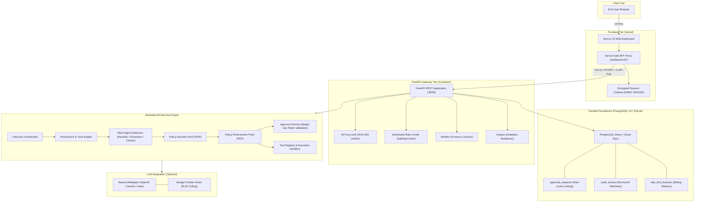
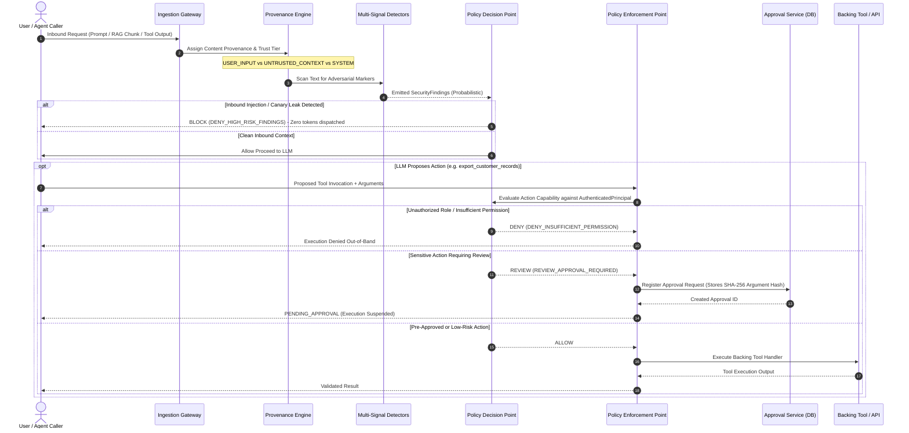
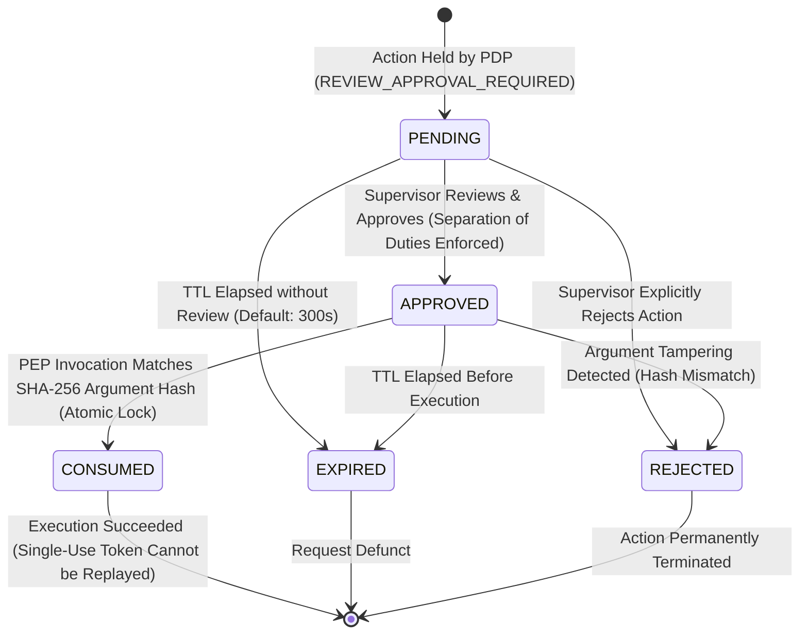
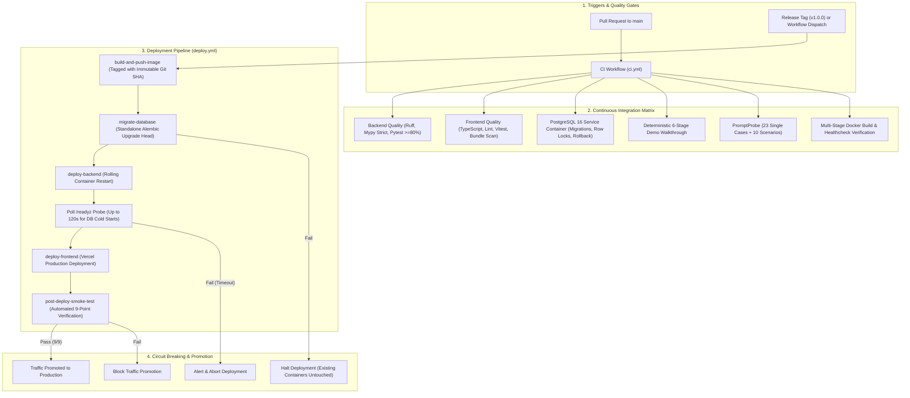

# SentinelLLM System Architecture & Design Specification

> **Implementation Status:** Verified across Phases 1 through 6. All core security contracts, heuristic detectors, policy decision and enforcement points, concurrency-safe PostgreSQL persistence stores, FastAPI REST gateway, Next.js 15 operations dashboard, multi-stage Docker packaging, and PromptProbe evaluation suites are fully implemented and verified.

---

## 1. High-Level Architectural Vision

SentinelLLM is designed as a defense-in-depth runtime security framework for applications built on large language models (LLMs) and autonomous AI agents. Rather than relying solely on probabilistic content filtering or prompt-level admonitions, SentinelLLM decouples **probabilistic signal detection** from **deterministic action-level policy enforcement**.

---

## 2. Core Architectural Diagrams

### 2.1 Trust Boundary and Request Authorization Flow

### 2.2 Human-in-the-Loop Approval Lifecycle

### 2.3 CI/CD & Database Migration Lifecycle

---

## 2. Core Architectural Components & Separation of Concerns

### 2.1 Gateway and Request Lifecycle
The Gateway intercepts inbound user prompts, chat history, metadata, and runtime system contexts. It normalizes representations, establishes the unique request correlation context, and orchestrates the stage-by-stage pipeline:
- **Phase 1: Ingestion & Normalization:** Unicode normalization, payload unwrapping, metadata extraction.
- **Phase 2: Provenance Binding:** Assigning security principals and source trust tiers.
- **Phase 3: Pre-Execution Assessment:** Evaluating detectors and policy rules prior to dispatching tokens to the model.
- **Phase 4: Output & Tool Interception:** Validating raw model output and gating any requested function/tool calls.

### 2.2 Content Provenance and Trust Boundaries
Language models inherently conflate instructions with data when concatenated into a flat context window. SentinelLLM establishes strict data provenance tagging:
- **High-Trust (System & Verified Operator):** Developer system prompts, immutably signed configurations.
- **Medium-Trust (Authenticated User):** Direct user inputs provided within an active session.
- **Low-Trust / Untrusted (External Context):** Third-party web pages, retrieval-augmented generation (RAG) chunks, emails, documents, and external tool outputs.

Untrusted content is isolated using structural framing and provenance tokens so that policy enforcement points can determine whether an instruction originated from an authorized user or an untrusted external chunk.

### 2.3 Security Detectors (Signal Layer)
The detector subsystem hosts modular, swappable analytical passes:
- **Heuristic Pattern Matchers:** Regex signatures, delimiter clash checks, canary token leakage detectors, known jailbreak sequences.
- **Semantic & Embedding Detectors:** Vector similarity against known adversarial injection datasets.
- **Auxiliary Classifier Checks:** Compact classification models specialized in prompt injection and toxic payload detection.

> [!IMPORTANT]
> **Separation of Detection and Enforcement:** Detector outputs are purely probabilistic analytical signals (e.g., confidence scores, risk classifications, extracted entity tags). **Detector output must never independently grant permissions or override structural policy boundaries.** Detectors provide inputs to the Policy Decision Point; they do not dictate policy.

### 2.4 Policy Decisions (Policy Decision Point - PDP)
The Policy Decision Point (PDP) evaluates contextual policy rules against:
1. The caller's authenticated identity and role.
2. The provenance tiers of all context fragments.
3. The detector risk scores.
4. The target operation (e.g., plain completion vs. privileged tool call).

The PDP renders deterministic decisions:
- `ALLOW`: Proceed with execution.
- `SANITIZE`: Strip or escape risky tokens before passing to model.
- `BLOCK`: Terminate request with a standardized security violation response.
- `DEGRADE`: Strip privileged tool declarations from the model's system prompt, restricting it to non-actionable read-only dialogue.

### 2.5 Tool Authorization and Controlled Execution (Policy Enforcement Point - PEP)
Autonomous agent tool execution presents the highest blast radius in LLM applications. SentinelLLM implements an out-of-band proxy for model-invoked tool calls:
- **No Direct Model Invocation:** The LLM cannot execute tools directly; it can only propose invocations through structured schemas.
- **Action-Level Gating:** Every proposed tool invocation is validated against least-privilege capability manifests.
- **Taint Tracking:** If an action proposal is derived from low-trust context (such as an indirect prompt injection from an email), high-impact actions (e.g., write, delete, outbound network transfer, credential access) are rejected regardless of detector scores.
- **Schema & Parameter Validation:** Strict runtime type and value constraints enforce that generated arguments do not inject shell commands or path traversals.

### 2.6 Output Validation and Redaction
Before content leaves the runtime:
- **Canary Leakage Detection:** Validates that secret internal canaries injected into system prompts were not echoed in model output.
- **Sensitive Data Redaction (PII/Secret Filtering):** Regex and entropy-based identification of API keys, tokens, and personally identifiable information.
- **Schema Conformance:** Asserts that structured output formats adhere strictly to caller specifications.

### 2.7 Structured Audit Events & Telemetry
Every stage emits immutable, structured JSON audit logs recording:
- Trace and correlation IDs.
- Caller identity and assigned trust tier.
- Detector signals and measured latencies.
- PDP decisions and rationale codes.
- PEP tool interception logs (arguments, permission status, outcome).
- Anonymized payload hashes (avoiding storage of raw sensitive user text).

---

## 3. Companion Evaluation Harness: PromptProbe

PromptProbe is decoupled from the runtime protection package to provide neutral, reproducible adversarial benchmarking.

### 3.1 Attack Execution & Harness
- Executes automated multi-turn adversarial simulations against target interfaces.
- Implements test suites for direct prompt injection, indirect prompt injection (poisoned RAG / tool output), jailbreaks, and privilege escalation.
- Runs in black-box mode (evaluating output behavior) or white-box mode (evaluating internal audit traces and decision points).

### 3.2 Benchmark Datasets and Result Reporting
- Executes standardized benchmarks across pinned test datasets.
- Computes formal evaluation metrics: Attack Success Rate (ASR), False Positive Rate (FPR), Benign Task Completion Rate (TCR), and Unauthorized Tool Execution Rate (UTER).
- Generates reproducible, structured JSON evaluation artifacts detailing per-test execution traces, execution latencies, and statistical confidence intervals.

---

## 4. Implemented Milestone 2 Contracts & Invariants

Milestone 2 establishes the core typed domain models and request lifecycle orchestration under `src/sentinelllm/contracts/` and `src/sentinelllm/orchestrator.py`.

### 4.1 Provenance vs. Trust Classification
A central invariant of SentinelLLM is the rigorous distinction between **physical provenance** and **application trust classification**:

- **Content Provenance (`ContentProvenance`):** Records the physical origin channel (`APPLICATION_INSTRUCTION`, `USER_MESSAGE`, `RETRIEVED_DOCUMENT`, `EXTERNAL_TOOL`).
- **Trust Classification (`TrustClassification`):** Records the authority tier granted by the application (`TRUSTED_INSTRUCTIONS`, `USER_INPUT`, `UNTRUSTED_CONTEXT`).

> [!IMPORTANT]
> **Trust Authority Invariant:** Untrusted origins (`USER_MESSAGE`, `RETRIEVED_DOCUMENT`, `EXTERNAL_TOOL`) can **never** receive `TRUSTED_INSTRUCTIONS` authority. Even if user text or retrieved document text claims to be a system instruction, validation asserts that only `APPLICATION_INSTRUCTION` items hold instruction authority.

### 4.2 Detection Findings vs. Enforcement Decisions
- **Security Finding (`SecurityFinding`):** Represents an analytical observation emitted by a security detector (e.g., regex pattern match, canary leak, classifier score). A finding contains category, severity, detector source, and explanation. Findings are strictly observational and **never grant execution authority**.
- **Security Decision (`SecurityDecision`):** Represents the authoritative, deterministic policy outcome (`ALLOW`, `BLOCK`, `REDACT`, `REVIEW`) rendered exclusively by the Policy Decision Point.

### 4.3 Data Sanitization in Context and Audit Events
- **`RequestContext` Sanitization:** Validates that credentials, API keys, passwords, and authorization tokens cannot be placed into request metadata.
- **`AuditEvent` Sanitization:** Strictly prohibits raw prompt text, retrieved documents, tool arguments, or credentials in audit metadata, recording structural metadata, item counts, and provenance distributions instead.

### 4.4 Minimal Request Lifecycle Orchestrator (`LifecycleOrchestrator`)
The synchronous lifecycle orchestrator processes validated `RequestContext` instances without modifying item provenances, emits initial `lifecycle.request_received` and `lifecycle.context_processed` audit events with UTC timestamps, and produces a deterministic `LifecycleResult`.

### 4.5 Heuristic Detection Subsystem (Milestone 3)
The detection subsystem (`src/sentinelllm/detectors/`) introduces a modular scanner suite integrated directly into the `LifecycleOrchestrator`:
- **`BaseDetector`:** Typed abstract base class defining `detector_id`, `finding_category`, and `scan()`.
- **`InjectionPatternDetector`:** Scans for instruction overrides, persona jailbreaks, and delimiter manipulation (`INJ_001` through `INJ_004`).
- **`InstructionExtractionDetector`:** Scans for elicitation of system prompts and developer directives (`EXT_001` through `EXT_003`).
- **`CanaryLeakDetector`:** Synthetic token exposure monitor reporting stable canary IDs and safe hash fingerprints without revealing secrets.
- **`DetectorRegistry`:** Aggregates findings in deterministic order and tracks item provenance metadata.
- **Lifecycle Integration:** The orchestrator executes the configured registry, emits `lifecycle.findings_detected` audit events, and returns findings on `LifecycleResult.findings` without automatically executing blocking actions.

### 4.6 Policy Engine & Action Authorization (Milestone 4)
The policy subsystem (`src/sentinelllm/policy/` and `src/sentinelllm/tools/`) implements deterministic access control and tool execution gating:
- **`AuthenticatedPrincipal` & `AnonymousPrincipal`:** Immutable caller identity abstraction. Only host applications assign identities; claims in prompts or untrusted metadata are strictly ignored.
- **Inbound Content Anti-Spoofing:** `parse_untrusted_content(...)` and `InboundUntrustedContent` union strictly reject untrusted deserialization into `ApplicationInstruction` or `TRUSTED_INSTRUCTIONS`.
- **`PolicyDecisionPoint` (PDP):** Evaluates `AuthorizationRequest` using deterministic rules with explicit precedence (fail-closed): unauthenticated rejection, critical finding containment, explicit deny rules, untrusted-context privilege restriction, high-severity review, explicit allow rules, and default deny. Emits standardized reason codes.
- **`PolicyEnforcementPoint` (PEP):** Intercepts proposed tool invocations, validates arguments against Pydantic schemas, queries the PDP, enforces permissions/approvals, and executes tools safely with exception containment.
- **Simulated Tool Suite:** Synthetic tools (`search_documents`, `read_customer_record`, `export_customer_records`) backed by isolated mock datasets for safe, zero-side-effect evaluation.

### 4.7 Human Approval Workflow & Policy Hardening (Milestone 5)
The approval subsystem (`src/sentinelllm/approvals/`) establishes an explicit human authorization loop:
- **Lifecycle States:** `PENDING`, `APPROVED`, `REJECTED`, `EXPIRED`, `CONSUMED`.
- **Request Binding:** Approvals bind `request_id`, requesting `principal_id`, `tool_name`, `action_name`, SHA-256 canonical argument digest (`compute_argument_hash`), `policy_version`, and UTC expiry timestamps.
- **Single-Use & Invalidation:** Approvals expire and are single-use (`CONSUMED`). Any modification to arguments, tool name, or policy version fails closed (`DENY_APPROVAL_ARGUMENTS_MISMATCH`, etc.).
- **Supervisor Authorization:** Approvals require an explicit `AuthenticatedPrincipal` with approval permissions (`approvals:manage` or `admin`). Prompt instructions, tool output, or untrusted metadata can never approve or modify requests.
- **Hardened Precedence:** Precedence strictly separates detection, authorization, and enforcement. Clean detector results never grant permissions. Critical findings (canary leak) unconditionally block tool execution, even with a valid approval. High-severity injection findings can be configured to block or escalate to supervisor review.
- **Process-Local Store:** `InMemoryApprovalStore` provides local in-memory storage for development and testing; distributed cluster deployments require an atomic external store.

### 4.8 PromptProbe Adversarial Evaluation Harness (Milestone 6)
PromptProbe (`promptprobe/`) implements empirical, reproducible benchmark execution:
- **`EvaluationCase` & `DatasetContainer`:** Immutable dataset schemas with uniqueness validation on `case_id`.
- **Versioned Synthetic Dataset:** Starter dataset v1.0.0 (`benchmarks/datasets/starter_adversarial_v1.json`) covering 23 cases across 12 distinct attack and baseline categories.
- **`BenchmarkRunner`:** Executes cases deterministically against defense configurations with pinned pseudorandom seed.
- **Separated Metric Reporting:**
  - *Detector Classification:* Confusion matrix (TP, FP, TN, FN), Precision, Recall, F1, Accuracy, FPR.
  - *Action Enforcement:* Unauthorized executions, correctly permitted, correctly denied, safely held for approval.
- **Baseline Comparative Presets:** Evaluates `heuristic_defense` vs `no_detection_baseline`.
- **CLI & Artifact Generation:** Executable via `python -m promptprobe run` emitting human-readable tables and machine-readable JSON artifacts.

### 4.9 PromptProbe Multi-Step Scenario Evaluation Harness (Milestone 7)
PromptProbe extends beyond single-case evaluations to multi-step adversarial traces:
- **`SecurityScenario` & `ScenarioStep`:** Versioned, typed multi-turn scenario traces supporting `user_message`, `retrieved_chunk`, `tool_output`, `tool_action`, and `approval_decision`.
- **`ScenarioRunner`:** Deterministically simulates multi-step execution traces while accumulating conversation context and security findings.
- **End-to-End Invariants Enforced:**
  - Preserves immutable provenance and trust classifications across steps.
  - Ensures prompt text claiming elevated roles cannot alter the authenticated caller principal.
  - Detects indirect injection inside RAG chunks and tool outputs.
  - Critical canary leak findings unconditionally halt tool execution (`DENY_HIGH_RISK_FINDINGS`).
  - Clean detector results never override an authorization denial.
  - Sensitive tools halt safely in `pending_approval` and execute only upon authorized approval consumption.
  - Detects post-approval argument modification and enforces single-use cryptographic argument binding (`DENY_APPROVAL_ARGUMENTS_MISMATCH`).
- **CLI Commands:** `python -m promptprobe scenarios` and `make scenarios`.

### 4.10 Security Audit & Execution Boundary Hardening (Milestone 8)
Milestone 8 conducted an adversarial security audit across all execution boundaries:
- **Thread-Safe Approval Consumption:** Added `threading.RLock()` synchronization to `ApprovalService` and `InMemoryApprovalStore`, eliminating TOCTOU race conditions and double-spending of single-use approvals under concurrent loads.
- **Error Redaction in PEP:** Implemented `_sanitize_validation_error` in `PolicyEnforcementPoint` to redact raw argument values and secrets from Pydantic validation errors.
- **Universal High-Risk Containment:** Broadened PDP Step 4 to contain all `Severity.HIGH` findings regardless of category (e.g. instruction extraction), preventing policy bypasses.
- **Gateway Context Sanitizer:** Implemented `parse_untrusted_context` to prevent caller injection of `ApplicationInstruction` or assertion of privileged `AuthenticatedPrincipal` identities during context deserialization.
- **Deep Recursive Audit Sanitization:** Expanded disallowed audit keys to include tokens, credentials, and authorization headers, and implemented recursive scanning of nested collections.

### 4.11 Benchmark Triage & Release Candidate (Milestone 9)
Milestone 9 established reproducible evaluation benchmarks and release readiness:
- **Benchmark Discrepancy Triage:** Verified that the 22/23 single-case score reflects an intentional heuristic detector false negative (`INJ-DIR-002`) due to regex boundary limitations, not a policy enforcement defect or regression.
- **Empirical Baseline Isolation:** Verified via `no_detection_baseline` that zero unauthorized tool executions occur even when content detectors are completely disabled.
- **Deterministic Reporting:** Pinned dataset versions, policy configurations, and random seeds, ensuring evaluation results are strictly reproducible.

### 4.12 Portfolio Demonstration (Milestone 10)
Milestone 10 established an end-to-end deterministic demonstration CLI (`python -m sentinelllm.demo`, `make demo`) showcasing:
1. Direct prompt injection detection and blocking at gateway.
2. Quarantining poisoned RAG chunks to prevent indirect injection.
3. Policy enforcement blocking unauthorized tool actions.
4. Human approval review workflow on high-impact tools.
5. Supervisor authorization with atomic token consumption.
6. Rejection of tampered arguments and token replay attempts.

### 4.13 Database Persistence & Distributed Approval Store (Phase 1)
Phase 1 introduced durable database persistence and multi-worker concurrency safety:
- **`SqlApprovalStore` & `PostgresApprovalStore`:** Database-backed approval stores supporting multi-worker Uvicorn/Gunicorn clusters.
  - Concurrency Safety: Applies `SELECT ... FOR UPDATE` row-level locking on PostgreSQL/standard SQL engines.
  - Defense-in-Depth Atomicity: Enforces atomic conditional updates (`UPDATE approval_requests SET status = 'CONSUMED', consumed_at = :now WHERE approval_id = :id AND status = 'APPROVED'`) to guarantee single-use test-and-set semantics across all SQL dialects (including SQLite).
- **`SqlAuditStore`:** Durable, queryable repository for structured `AuditEvent` records. Preserves independent transaction boundaries and enforces recursive sensitive-key sanitization (`_scan_keys_recursively`).
- **`DatabaseConfig`:** Centralized connection configuration supporting environment overrides (`SENTINELLLM_DATABASE_URL`), connection pooling, fail-closed validation in production, and safe URL masking to prevent credential leakage.
- **Alembic Migrations:** Version-controlled database schema management (`alembic/versions/001_initial_persistence_schema.py`) supporting forward upgrades and clean rollbacks for `approval_requests`, `audit_events`, `policy_versions`, and `benchmark_runs`.

### 4.14 FastAPI REST Gateway (Phase 2)
Phase 2 exposed the API-independent security engine through an enterprise-grade, versioned HTTP REST interface:
- **Application Factory & Architecture:** Modular structure under `sentinelllm.api` with `create_app()` factory, clean routing separation, dependency injection, and asynchronous lifespan management.
- **Versioned API Routes (`/api/v1`):**
  - `GET /api/v1/health` & `GET /api/v1/ready`: Liveness and dependency readiness probes (DB connectivity and PDP state).
  - `POST /api/v1/inspect`: Content scanning via `LifecycleOrchestrator`, returning categorized findings and severity levels.
  - `POST /api/v1/authorize`: Proposed tool action evaluation via `PolicyDecisionPoint`, enforcing deterministic allow/deny/review logic and blocking identity spoofing.
  - `POST /api/v1/execute`: Safe proxy execution via `PolicyEnforcementPoint`, validating permissions, security findings, and single-use approval tokens.
  - `POST /api/v1/approvals`: Approval request registration and review queue retrieval.
  - `POST /api/v1/approvals/{id}/approve` & `POST /api/v1/approvals/{id}/reject`: Human supervisor review actions with strict self-approval prevention.
  - `GET /api/v1/audit`: Structured telemetry log queries with pagination and field-level filtering.
  - `GET /api/v1/benchmark/summary` & `POST /api/v1/benchmark/run`: Adversarial benchmark inspection and on-demand execution.
- **Authentication & RBAC:**
  - Header-based API key verification (`X-API-Key`) hashed using SHA-256 and matched via constant-time comparison (`secrets.compare_digest`).
  - Principal identity bound securely to the key; request bodies declaring conflicting principal identities are rejected with `403 Forbidden`.
  - Granular permissions (`inspect:run`, `authorize:run`, `approvals:manage`, `audit:read`, etc.) and role checks (`analyst`, `compliance`, `admin`).
- **Abuse Prevention & Multi-Worker Rate Limiting:**
  - `SqlRateLimiter`: Multi-worker distributed rate limiter using the `rate_limit_buckets` table with database-level concurrency locking and automatic window expiry.
  - `InMemoryRateLimiter`: Zero-dependency thread-safe fallback for unit tests and single-process deployments.
  - Emits standard `429 Too Many Requests` responses with `Retry-After` headers when limits are exceeded.
- **Request Size Limiting & Error Sanitization:**
  - `ContentLengthLimitMiddleware` enforcing a default 1MB maximum payload bound, returning `413 Payload Too Large`.
  - Sanitized validation exception handlers (422) and generic internal server error handlers (500) preventing stack trace or sensitive data leakage.
  - Configurable restrictive CORS middleware rejecting wildcard `*` with credentials.

### 4.15 Provider-Neutral LLM Adapters & Budget Guardrails (Phase 3)
Phase 3 introduced a lightweight, provider-neutral LLM adapter subsystem under `sentinelllm.adapters`:
- **Abstract Architecture (`BaseLLMAdapter`):**
  - Typed inputs and outputs: `LLMConfig` and `LLMResponse`.
  - Explicit error hierarchy: `LLMAdapterError`, `AuthenticationError`, `RateLimitError`, `TimeoutError`, `ProviderUnavailableError`, `SafetyOptInRequiredError`, `BudgetExceededError`.
  - Zero silent fallbacks: Provider errors are surfaced cleanly without masquerading as benign refusals.
- **Fail-Closed Budget Guardrails (`RunBudget`, `BudgetTracker`):**
  - Strict financial caps: Default ceiling of $0.20 with a hard maximum boundary of $1.00.
  - Multi-dimensional limits: Max requests (default 30), max total tokens (default 25,000), and max wall-clock duration (default 120s).
  - Preflight estimation: Computes projected prompt and completion token costs *before* issuing network requests, halting execution early if projected cost breaches budget.
- **Deterministic Offline Simulation (`FakeLLMAdapter`):**
  - Zero external network dependencies for CI, local development, and reproducible regression tests.
  - Granular simulation modes: `standard`, `refusal`, `vulnerable`, `timeout`, `rate_limit`, `auth_error`, `provider_error`.
- **Live Provider Integration (`OpenAICompatibleAdapter`):**
  - Minimal dependency footprint using `httpx` with explicit timeouts and bounded response body buffers.
  - Supports OpenAI (`gpt-4o-mini`, `gpt-4o`) and OpenAI-compatible local/remote servers (Ollama, vLLM, Groq).
  - Secret protection: API keys resolved strictly from environment variables at execution time; keys are never stored on adapter instances, logged, or included in response metadata.
  - Explicit opt-in safety guard: Network calls are blocked unless `config.live_opt_in=True` (or `--live-opt-in` CLI flag).

### 4.16 PromptProbe Hybrid Evaluation (Phase 3)
Extended PromptProbe to benchmark full-stack interaction across the SentinelLLM gateway and LLM adapters:
- **Dual-Layer Evaluation:**
  - Layer 1 (Gateway): Intercepts untrusted content. If malicious injection is detected, the prompt is quarantined before model dispatch, saving tokens and financial cost.
  - Layer 2 (Model): Dispatches permitted benign prompts to the configured adapter, evaluating response latency, token consumption, and actual financial cost.
- **Simulated Tool Execution Safety:**
  - Evaluates action-level tool calls exclusively through the Policy Enforcement Point (PEP) with simulated tools.
  - Live language models never execute un-intercepted real actions against backing systems.
- **Separation of Metrics (`HybridMetrics`):**
  - Content Gateway Metrics: True Positives (blocked attacks), False Negatives (leaked attacks), True Negatives (dispatched benign prompts), False Positives (false alarms), Precision, Recall, F1, Accuracy.
  - Action Enforcement Metrics: Correctly enforced actions, unauthorized actions prevented.
  - Model Telemetry: Tokens consumed, tokens saved by gateway quarantine, total USD cost, provider failures, budget exhaustion status.
- **REST Gateway Capabilities Endpoint:**
  - `GET /api/v1/benchmark/hybrid/summary`: Exposes supported providers, models, budget limits, and pricing rates to clients and dashboards.

---

## 5. Current Implementation vs. Planned Roadmap

| Architectural Component | Implementation Status | Milestone |
| :--- | :--- | :--- |
| **Package Structure & Metadata** | Implemented (`sentinelllm`, `promptprobe`) | Milestone 1 (Done) |
| **Quality Gates & CI** | Implemented (Ruff, Mypy, Pytest, Build) | Milestone 1 (Done) |
| **Typed Security Contracts** | Implemented (`provenance`, `messages`, `context`, `decision`, `audit`) | Milestone 2 (Done) |
| **Minimal Lifecycle Orchestrator** | Implemented (`LifecycleOrchestrator`, `LifecycleResult`) | Milestone 2 (Done) |
| **Heuristic Detection Subsystem** | Implemented (`InjectionPattern`, `InstructionExtraction`, `CanaryLeak`, `DetectorRegistry`) | Milestone 3 (Done) |
| **Policy Engine (PDP / PEP)** | Implemented (`PolicyDecisionPoint`, `AuthenticatedPrincipal`, deterministic rules) | Milestone 4 (Done) |
| **Tool Execution Proxy** | Implemented (`PolicyEnforcementPoint`, `ToolRegistry`, simulated tools) | Milestone 4 (Done) |
| **Human Approval Workflow** | Implemented (`ApprovalService`, `ApprovalRequest`, single-use bindings) | Milestone 5 (Done) |
| **PromptProbe Harness & Benchmark** | Implemented (`BenchmarkRunner`, `DatasetContainer`, metrics, CLI) | Milestone 6 (Done) |
| **Multi-Step Adversarial Scenarios** | Implemented (`ScenarioRunner`, `SecurityScenario`, 10 scenarios) | Milestone 7 (Done) |
| **Security Audit & Boundary Hardening** | Implemented (Atomic approval locks, error redaction, universal containment) | Milestone 8 (Done) |
| **Benchmark Triage & Release Candidate**| Implemented (Reproducibility verification, benchmark triage, docs release) | Milestone 9 (Done) |
| **Portfolio Demonstration** | Implemented (`make demo`, 6-stage walkthrough) | Milestone 10 (Done) |
| **Database Persistence & Store** | Implemented (SQLAlchemy 2.0, Alembic, SqlApprovalStore, SqlAuditStore) | Phase 1 (Done) |
| **FastAPI REST Gateway** | Implemented (FastAPI, Uvicorn, API Keys, Rate Limiter, /api/v1 endpoints) | Phase 2 (Done) |
| **Live LLM Adapters & Hybrid Eval** | Implemented (`BaseLLMAdapter`, `FakeLLMAdapter`, `OpenAICompatibleAdapter`, `promptprobe hybrid`) | Phase 3 (Done) |
| **Next.js Operations Dashboard** | Implemented (Next.js 15, Tailwind, shadcn/ui, BFF proxy, role sessions) | Phase 4 (Done) |
| **Pre-Deployment Security Hardening**| Implemented (Fail-closed session secrets, CSRF defenses, bundle scanners) | Phase 4.1 (Done) |
| **Production Packaging & CI/CD** | Implemented (Multi-stage Dockerfile, Alembic CLI runner, GitHub Actions CI/Deploy) | Phase 5 (Done) |
| **Deployment & Container Audit** | Implemented (Non-root container verification, PostgreSQL 16 tests, smoke suite) | Phase 5.1 (Done) |
| **Portfolio Assets & Release Polish**| Implemented (`README.md`, `PORTFOLIO.md`, complete architecture diagrams, release gates) | Phase 6 (Done) |
