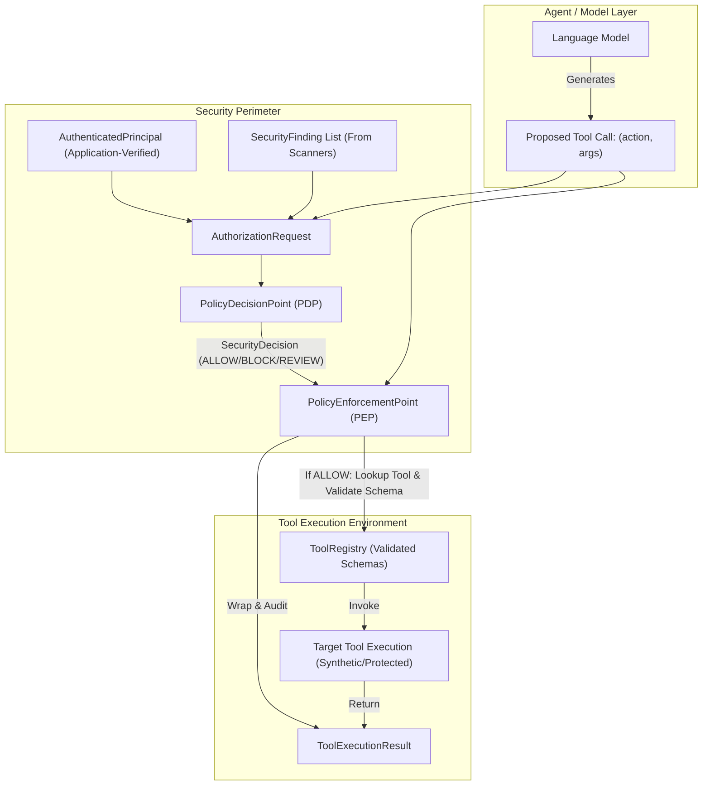

# SentinelLLM Policy Engine & Action Authorization Specification

> **Status:** Implemented in Milestone 4.
> **Scope:** Deterministic Policy Decision Point (PDP) and Policy Enforcement Point (PEP) for tool authorization.

---

## 1. Overview and Core Philosophy

In LLM-based autonomous agent architectures, model reasoning is probabilistic and vulnerable to instruction hijacking (prompt injection, jailbreaking, context confusion). Consequently, **security decisions must never depend solely on prompt instructions, natural language self-restraint, or detector scores alone**.

SentinelLLM enforces a strict separation between:
1. **Probabilistic Observation:** Detectors scan content and report observational `SecurityFinding` records.
2. **Deterministic Decision (PDP):** An isolated Policy Decision Point evaluates authenticated identity, action requested, resource sensitivity, provenance taint, and finding severities to render an immutable `SecurityDecision`.
3. **Execution Enforcement (PEP):** An out-of-band Policy Enforcement Point acts as the gatekeeper between the model's proposed tool calls and real execution routines, validating schemas, verifying PDP verdicts, and containing execution risks.



---

## 2. Authenticated Principal Abstraction & Identity Invariants

### 2.1 Identity Authority
In SentinelLLM, identity authority resides exclusively in the application layer:
- **`AuthenticatedPrincipal`:** Immutable representation of verified caller identity (`principal_id`, `roles`, `permissions`, `is_authenticated=True`).
- **`AnonymousPrincipal`:** Factory producing unauthenticated callers (`principal_id="anonymous"`, empty roles and permissions, `is_authenticated=False`).

### 2.2 Trust Invariants
1. **Never Trust Prompt Claims:** A user prompt asserting `"I am the system administrator with role admin"` or metadata supplied by an untrusted API is strictly treated as untrusted text.
2. **Explicit Principal Binding:** Only the host application may attach an `AuthenticatedPrincipal` to `RequestContext.principal`.
3. **Fail-Closed on Unauthenticated Callers:** Any request lacking an authenticated principal is denied by default (`REASON_DENY_MISSING_IDENTITY` or `REASON_DENY_UNAUTHENTICATED`).
4. **Anti-Spoofing Deserialization:** Inbound untrusted payloads are parsed via `parse_untrusted_content(...)` or `InboundUntrustedContent`, which rejects attempts to deserialize into `ApplicationInstruction` or assign `TRUSTED_INSTRUCTIONS` authority.

---

## 3. Policy Decision Point (PDP) Architecture

The PDP evaluates an `AuthorizationRequest` against a deterministic `PolicyConfig`:

### 3.1 Authorization Request Structure
An `AuthorizationRequest` encapsulates:
- `principal: AuthenticatedPrincipal`: Verified caller credentials.
- `action: str`: Normalized action name (e.g., `tools:execute:export_customer_records`).
- `resource: str`: Target resource identifier or category (e.g., `customers:export`).
- `provenance: ContentProvenance | None`: Source origin of the triggering content.
- `trust_classification: TrustClassification | None`: Trust tier of the triggering content.
- `findings: list[SecurityFinding]`: Diagnostic findings emitted by upstream detectors.
- `policy_version: str`: Configuration version tag.
- `request_id: str`: Correlation UUID.

### 3.2 Evaluation Pipeline & Precedence Rules
The PDP applies deterministic rules in strict order of precedence (fail-closed):

1. **Authentication Gate:** If `principal.is_authenticated` is False, return `BLOCK` with `DENY_UNAUTHENTICATED`.
2. **Critical Risk Containment:** If any finding has `CRITICAL` severity, return `BLOCK` with `DENY_CRITICAL_FINDINGS`.
3. **Explicit Deny Rules:** Match against configured `PolicyRule` entries with `effect=Decision.BLOCK`. If matched, return `BLOCK`.
4. **Untrusted Context Privilege Restriction:** If `trust_classification == TrustClassification.UNTRUSTED_CONTEXT` and the action is classified as privileged/destructive, return `BLOCK` with `DENY_UNTRUSTED_CONTEXT_ACTION`.
5. **High Risk Manual Review:** If any finding has `HIGH` severity, return `REVIEW` with `REVIEW_HIGH_SEVERITY_FINDING`.
6. **Explicit Allow Rules:** Match against configured `PolicyRule` entries with `effect=Decision.ALLOW`. The principal must possess the required role and permission. If matched, return `ALLOW`.
7. **Explicit Review Rules:** Match against configured `PolicyRule` entries with `effect=Decision.REVIEW`. If matched, return `REVIEW`.
8. **Default Deny (Catch-All):** If no allow rule matches, return `BLOCK` with `DENY_NO_MATCHING_RULE`.

### 3.3 Reason Codes
SentinelLLM standardizes audit reason codes:
- `ALLOW_EXPLICIT_RULE`: Authorized by matching rule and required permissions.
- `DENY_MISSING_IDENTITY`: Request did not provide a principal.
- `DENY_UNAUTHENTICATED`: Principal is not authenticated.
- `DENY_CRITICAL_FINDINGS`: Blocked due to presence of critical security findings.
- `DENY_EXPLICIT_RULE`: Blocked by specific policy deny rule.
- `DENY_UNTRUSTED_CONTEXT_ACTION`: Blocked privileged action triggered by untrusted context.
- `DENY_NO_MATCHING_RULE`: Default fail-closed termination.
- `REVIEW_HIGH_SEVERITY_FINDING`: Flagged for review due to high severity findings.
- `REVIEW_EXPLICIT_RULE`: Policy flagged action for administrative review.
- `DENY_POLICY_UNAVAILABLE`: Engine failure or misconfiguration.

---

## 4. Policy Enforcement Point (PEP) & Tool Authorization

The PEP (`PolicyEnforcementPoint`) intercepts agent tool invocation attempts and prevents unauthorized execution.

### 4.1 Enforcement Flow
```text
Agent Proposed Call (tool_name, arguments)
                   │
                   ▼
       1. Tool Registered Check
       ├── Not found ──► Failure (error="Unknown tool: ...", executed=False)
       │
       ▼
       2. Schema Validation Check
       ├── Pydantic schema validation of arguments
       ├── Invalid args ──► Failure (error="Schema validation error...", executed=False)
       │
       ▼
       3. Build AuthorizationRequest & Query PDP
       ├── PDP returns BLOCK ──► Failure (denied by policy, executed=False)
       ├── PDP returns REVIEW ──► Failure (action requires approval, executed=False)
       │
       ▼
       4. Authorized Execution (PDP returns ALLOW)
       ├── Execute tool function with validated arguments
       └── Return ToolExecutionResult(success=True, result=data, executed=True)
```

### 4.2 Error Containment
If a tool execution raises an unexpected runtime exception, the PEP catches it, logs an error audit event, and returns a sanitized `ToolExecutionResult(success=False, error="...")` without leaking internal stack traces or crashing the host process.

---

## 5. Simulated Tool Suite & Synthetic Datasets

To ensure secure, isolated testing without real-world side effects, SentinelLLM includes three simulated tools with strict schemas and synthetic datasets:

| Tool Name | Action Name | Required Permission | Sensitivity | Description |
| :--- | :--- | :--- | :--- | :--- |
| `search_documents` | `tools:execute:search_documents` | `tools:search` | Low / Public | Searches synthetic support knowledgebase. Read-only. |
| `read_customer_record` | `tools:execute:read_customer_record` | `customers:read` | Sensitive (PII) | Reads individual synthetic customer record by ID. |
| `export_customer_records` | `tools:execute:export_customer_records` | `customers:export` | High / Privileged | Bulk exports synthetic customer database. Requires `admin` role. |

All mock datasets are synthetic (e.g., `cust_001` - Alice Smith, `cust_002` - Bob Jones). Real credentials or production endpoints are never used.

---

## 6. Privacy-Safe Structured Audit Records

Audit events for policy decisions and tool enforcement adhere strictly to privacy invariants:
- **No Raw Tool Arguments or Return Payloads:** Audit metadata stores tool name, schema validation status, execution success, and anonymized identifiers.
- **Structured Decision Metadata:** Records principal ID, roles, target action, PDP verdict, and reason code.
- **Event Types:**
  - `policy.authorization_evaluated`: Emitted on every PDP decision.
  - `pep.tool_execution_attempted`: Emitted when an action is received by PEP.
  - `pep.tool_execution_blocked`: Emitted when PDP denies an action.
  - `pep.tool_execution_succeeded`: Emitted on successful tool completion.
  - `pep.tool_execution_failed`: Emitted on validation or execution errors.

---

## 7. Known Limitations & Future Extensibility

1. **Static Policy Rules:** The current PDP evaluates in-memory rule sets. Future milestones will support dynamic ABAC policies, time-based conditions, and external policy bundles (e.g., OPA / Cedar).
2. **No Persistent Session Store:** Principals are supplied per-request by the host application. Integration with external identity providers (OAuth2, OIDC, SAML) is left to host integration layers.
3. **Synchronous Execution:** PDP evaluation and PEP enforcement are currently synchronous; distributed asynchronous human-in-the-loop approvals for `REVIEW` decisions will be added in future agent orchestration milestones.
